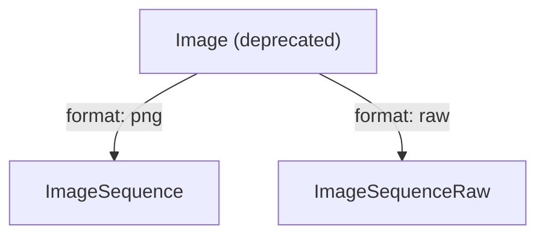
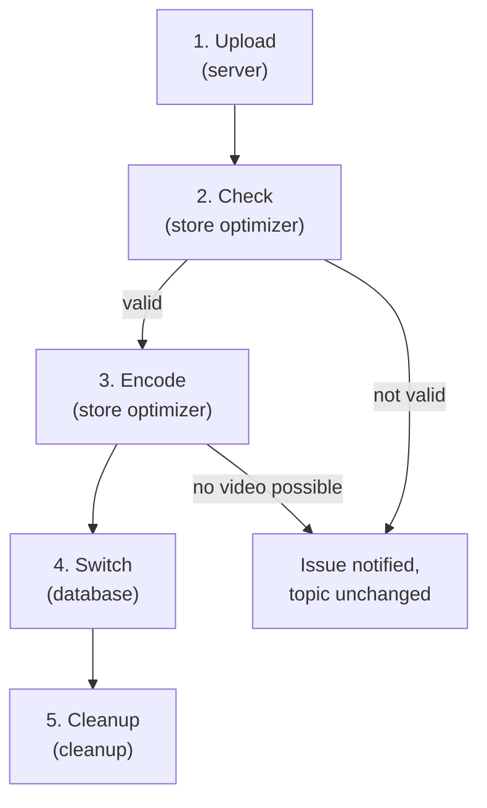
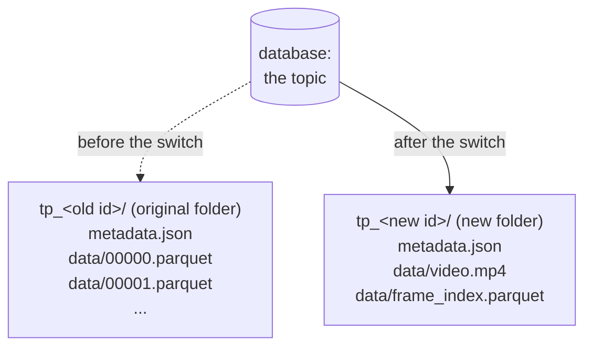

# Image Sequences

## Summary

This RFC adds two ontologies to Mosaico, which store the images of a camera
on `mosaicod` together with the time each image was captured. Each ontology
has its own serialization format:

- `ImageSequence`: PNG images, compressed losslessly
- `ImageSequenceRaw`: raw images, as a camera driver writes them. For
  example, the images of a ROS bag.

Their main goal is to replace the `Image` ontology, which becomes deprecated
for the reasons explained in the Motivation, and will be removed in a future
release. The `CompressedImage` ontology,
for lossy images and video streams, is not affected by these changes.

The client uploads the images to `mosaicod` as they are. Later, the store
optimizer checks the content of the images and then, if it is possible, it
turns the whole sequence into a lossless FFV1 video.

The video holds only the pixels of the images, so everything else the client
uploaded is saved in a Parquet file next to it, called the **frame index**.
The frame index has a row for each image, with its timestamps and its other
fields: the coordinate frame of the camera and the number of the image, both
taken from the ROS header, and any other field the client added to the
ontology. For a raw image, the row also describes how its bytes are laid
out, so that the video and the frame index together can rebuild every
image: a raw image byte for byte, and a PNG pixel for pixel.

The choice of turning images into a video comes from the fact that a video
encoded with FFV1 keeps every pixel exactly and takes less space than the
original images, as shown by the [file size graph][filesize] of the
[ffv1-analysis PoC][ffv1-analysis].

The client sends the image sequence using one of the two ontologies, and it
is saved in the object store as a topic, whose data lives in a folder. The
store optimizer does not modify the original folder of the topic, which
holds the images, but it writes the video and the frame index into a new
folder. Once the video is successfully written in the object store, the
database swaps the topic to the new folder in a single transaction, and from
then on the topic contains the video instead of the images. The original
folder containing the images is not deleted immediately, but a separate
cleanup process deletes it after a retention period of 24 hours by default,
as it already does for the other folders that are no longer used.

A client can read back an image sequence in two ways:

- **The images**, which come back as they were uploaded, with all their
  fields and in recording order. A raw image comes back identical, byte for
  byte. A PNG, instead, comes back as the same image, pixel for pixel: once
  decoded, every pixel has exactly the value it had in the uploaded PNG.
  However, the bytes of the file can differ, because the server writes a
  **new PNG** from the pixels of the video, and it can use different
  optimization settings from those of the original file.
- **The video**, as a whole or only some of its seconds. The video comes
  back cut into segments of **one second**, in MPEG-DASH, a standard streaming
  format. Each segment starts with a complete image, so it can be played
  without the previous segments, and it comes with the exact recording and
  capture times of each of its images.

## Glossary

This RFC uses some video terms, explained here in simple words:

- **Frame**: one image of a video.
- **Raw image**: an image stored as uncompressed pixels, as in a ROS
  `sensor_msgs/Image`. A camera can send its images compressed, for
  example as JPEG, and its driver then decodes them into raw images. Here,
  raw means only uncompressed, unlike the RAW files of photography, which
  hold the data of the sensor before any processing.
- **Stride**: the number of bytes of each row of a raw image.
- **Padding**: the extra bytes that some cameras add at the end of each row
  of a raw image, after the pixels. They make every row start at a memory
  address that the hardware reads faster, such as a multiple of 64 bytes,
  so the stride becomes larger than the pixels of a row.
- **Lossless**: a compression that keeps every pixel exactly.
- **Lossy**: a compression that changes some pixels to save more space.
- **Codec**: how the pixels of each frame are compressed. Here it is FFV1.
- **Intra-frame codec**: a codec that compresses each frame using only its
  own pixels, never those of other frames, such as FFV1.
- **Keyframe**: a frame that can be decoded on its own, without the frames
  before or after it.
- **Container**: the file that stores the compressed frames and their
  times. Here it is MP4.
- **Box**: a block of bytes of an MP4 file, with its size and a name of
  four letters that says what it holds. For example, `moov` holds the
  description of the video, and `mdat` the compressed frames.
- **Fragmented MP4**: an MP4 file made of a header, the `ftyp` and `moov`
  boxes, followed by fragments.
- **Fragment**: a part of a fragmented MP4 file, made of two boxes: `moof`,
  which describes some frames and their times, and `mdat`, which holds
  those frames.
- **MPEG-DASH**: a standard way to send a fragmented MP4 file as many
  small files, called segments, together with a manifest.
- **Manifest**: the file that lists the segments of a video.
- **Initialization segment**: the segment that holds the header of the
  fragmented MP4 file, the `ftyp` and `moov` boxes.
- **Media segment**: a segment that holds some fragments of the fragmented
  MP4 file, here the fragments of one second of video, after a small
  `styp` box that marks the start of the segment.

## Motivation

Robots and vehicles record long sequences of camera images, which are often
the largest part of a recording and so of its storage cost.

The `Image` ontology was created to store the images of ROS bags, but it has
three problems that prevent the server from turning a topic into a video:

- **One ontology for different things.** A message holds either raw pixels
  or a PNG, depending on its `format` field, so the kind of image is not
  fixed by the ontology but can change from message to message. A topic can
  then mix raw images and PNGs, and the server has no guarantee about what
  it holds: it has to look at every message, and to handle each kind of
  image differently, both to build the video and to give the images back as
  they were uploaded.
- **No capture time.** The time the camera took the image is in an
  **optional** header, and without it the server cannot order the frames of
  a video.
- **Images compressed one by one.** In the Parquet files, each image is a
  separate value, compressed with a general purpose algorithm that knows
  nothing about images. A PNG is already compressed, so it does not shrink,
  and raw pixels shrink only a little, so the stored images take almost as
  much space as the original ones.

The new ontologies solve these problems, because each of them holds a single
kind of image, and every image has its capture time. So the server can check
the images of a topic and then turn them into a single video, without losing
any data.

For this reason, this RFC introduces two ontologies that split `Image` by
kind of image:

- `ImageSequence` for PNGs, which are already compressed when they reach
  the server
- `ImageSequenceRaw` for raw images, which are the largest data, and so the
  ones that the video compresses the most. The ontology keeps every field of
  a ROS image message, so that a ROS bag can be rebuilt exactly.



Each ontology has **only** the fields its kind of image needs, so that every
message fully describes its image. All of them are required, except the two
that come from the ROS header, because not every source fills them:

- `frame_id`, the coordinate frame of the camera
- `sample_counter`, the number of the image, which exists only in ROS 1,
  where it is the `seq` field of the header

The capture time, instead, which in ROS is the `stamp` field of the header,
is **always** required. In the new ontologies it is a field of its own, called
`capture_timestamp_ns`, while in `Image` it is inside the optional header.

## Design

### The data flow, from client to server

An image sequence goes through five phases. Only the first one involves the
client and the server, `mosaicod server`, while the others run later in two
separate processes of the same binary: `mosaicod store-optimizer` and
`mosaicod cleanup`.



1. **Upload.** The client creates a topic with one of the two ontologies
   and pushes one message per image, which `mosaicod server` writes into
   Parquet files. The server **does not check the images**, because
   decoding them would make the upload too slow.
2. **Check.** Later, the **store optimizer** takes the complete topics that
   are not optimized yet. A topic finalized without any image has nothing to
   optimize, so its optimization ends here, without a video and without a
   notification, and the topic stays empty. Otherwise, if the topic is an
   `ImageSequence`, the optimizer checks every image without decoding it:
   - the `format` field of the image is not empty, and its value is a
     format the server can turn into a video, which currently is only `png`
   - the format is the same for all the images of the topic
   - the bytes of the image really are an image of the format declared in
     its `format` field

   If the topic is an `ImageSequenceRaw`, instead, the raw images cannot be
   checked without decoding them, so they are checked in the next Encode
   phase. While they are decoded, their bytes must match the size and the
   stride given by their `width`, `height` and `stride` fields.
3. **Encode.** The optimizer decodes each image once and then encodes the
   images into a lossless **FFV1 video**. The video and its frame index are
   written in a new folder of the store, while the topic still uses its
   original folder.
4. **Switch.** Once the video is written, a single database transaction
   switches the topic to the new folder, so that from then on the topic
   contains the video instead of the images.
5. **Cleanup.** The old folder with the Parquet files is no longer used, so
   the **cleanup** marks it and deletes it after the retention period.

### The ontologies

In both ontologies, each message is one image. As in every ontology, the
message has `timestamp_ns`, which is when the image was **recorded**.

`ImageSequence`, PNG images:

| Field | Type | Null | Description |
|---|---|---|---|
| `format` | `string` | no | The encoding of the image. Only `png`. |
| `capture_timestamp_ns` | `int64` | no | When the camera **took** the image, in nanoseconds since the Unix epoch. |
| `frame_id` | `string` | yes | The coordinate frame of the camera, from the ROS header. |
| `sample_counter` | `uint64` | yes | The number of the image, from the ROS 1 header (`seq`). |
| `data` | `binary` | no | The PNG. |

`ImageSequenceRaw`, raw images:

| Field | Type | Null | Description |
|---|---|---|---|
| `capture_timestamp_ns` | `int64` | no | When the camera **took** the image, in nanoseconds since the Unix epoch. |
| `width` | `uint32` | no | Pixels per row. |
| `height` | `uint32` | no | Rows. |
| `stride` | `uint32` | no | Bytes per row, padding included. |
| `encoding` | `string` | no | The pixel encoding, as in ROS: `mono8`, `bgr8`, `16UC1`... |
| `is_bigendian` | `bool` | yes | Whether 16-bit samples are big-endian, otherwise little-endian. |
| `frame_id` | `string` | yes | The coordinate frame of the camera, from the ROS header. |
| `sample_counter` | `uint64` | yes | The number of the image, from the ROS 1 header (`seq`). |
| `data` | `binary` | no | The pixels, `stride × height` bytes. |

Queries can filter on every field except `data`.

Only **lossless** images are considered by these ontologies, so that the
server stores exactly what the camera produced. Lossy images, such as JPEG,
are handled by the `CompressedImage` ontology.

### ROS images

In ROS, a raw camera image is a message of type `sensor_msgs/Image`. The ROS
bridge turns each of these messages into an `ImageSequenceRaw`, and on
export it turns it back into the same message:

| ROS | `ImageSequenceRaw` |
|---|---|
| `header.stamp` | `capture_timestamp_ns` |
| `header.frame_id` | `frame_id`, null if empty |
| `header.seq` (ROS 1 only) | `sample_counter` |
| `width`, `height`, `step` | `width`, `height`, `stride` |
| `encoding`, `is_bigendian` | `encoding`, `is_bigendian` |
| `data` | `data` |

An image whose stamp is zero has no capture time, because its driver did
not fill it, so it cannot become an `ImageSequenceRaw`. However, these
images are ingested today as `Image`, which needs no capture time, and a bag
that is ingested today must not fail after this change. For this reason,
the ROS bridge chooses the ontology of each topic from its first image:

- if its stamp is not zero, the topic is an `ImageSequenceRaw`
- if its stamp is zero, the topic is an `Image`, as before this RFC, and the
  bridge warns the user that the topic is stored with a deprecated ontology

The choice holds for the whole topic, because the ontology of a topic is
fixed when the topic is created. So a topic whose first image has a stamp,
and a later one has none, stays an `ImageSequenceRaw`, and that later image
is refused as the error policy of the topic says (see the [open questions
about ROS images][ros-open-questions]).

The user can also choose `Image` for a topic, whatever its stamps, through
the adapter `ImageAdapter.using(Image)`, which is deprecated too.

### `Image` is deprecated

`Image` topics can still be written and read, but creating one for writing
warns the user to use `ImageSequenceRaw` instead. The `Image` topics already
stored are still exported to ROS.

`Image` will be removed in a future release. Until then, it is kept for the
ROS images that have no capture time, as explained in [ROS
images](#ros-images), and for the clients that still write it.

### The serialization formats

There are two new serialization formats, `ImageSequence` and
`ImageSequenceRaw`, one for each ontology. On disk they are Parquet files,
like the other formats, and only the settings of each column change. The
formats find the columns by their names, so the fields of the ontologies
must not be renamed.

`ImageSequence`:

| Column | Compression | Statistics |
|---|---|---|
| `timestamp_ns` | none | page statistics and a bloom filter |
| `capture_timestamp_ns` | ZSTD, level 5 | page statistics |
| `format`, `frame_id` | dictionary, then ZSTD, level 5 | page statistics |
| `data` | none, because a PNG is already compressed | none |
| `sample_counter` and any other column | none | none |

`ImageSequenceRaw`:

| Column | Compression | Statistics |
|---|---|---|
| `timestamp_ns` | none | page statistics and a bloom filter |
| `capture_timestamp_ns` | ZSTD, level 5 | page statistics |
| `width`, `height`, `stride`, `encoding`, `is_bigendian`, `frame_id` | dictionary, then ZSTD, level 5 | page statistics |
| `data` | ZSTD, level 3 | none |
| `sample_counter` and any other column | none | none |

The `data` of a raw image is compressed with ZSTD level 3, because it is a
good balance between space and speed.

### Store optimizer errors

When the optimizer finds a problem, it **leaves the topic as the client sent
it**, so the topic stays readable. Then it adds an error notification to the
topic, which is a new row of the `topic_notification_t` table of the
database, with the id of the topic, the type `error`, and the error message
`store optimizer/<issue>: <details>`. The `<issue>` value can be one of these:

- `format_mismatch`: a PNG has no format, an unsupported one, or one
  different from the other images
- `undecodable`: a PNG is not valid or its pixels are corrupted, or the
  bytes of a raw image do not match its size and stride
- `unsupported`: the images cannot become a video without losing
  information, because:
  - a required field is missing
  - the images have different sizes, color types or bit depths
  - a PNG has a layout that cannot be decoded
  - a raw image has an encoding the video cannot hold yet
  - a raw image has row padding that is not zero: the padding is made of
    the bytes at the end of each row that are not pixels, and the video
    keeps only the pixels, so it would lose them (see the [open questions
    about supported images][supported-images])
  - a field added by extending the ontology has the name of a column of the
    frame index: `frame`, `video_timestamp_us`, `fragment_offset` or
    `fragment_size`. Any other added field, for example `exposure_us`, is
    always kept in the frame index.
- `failed`: something outside the data failed, such as the encoder, the
  store, the network or the database

The first three issues depend on the data, so **the optimization of the topic
ends and it is never tried again**. A `failed` topic, instead, is tried again
at the next run, and a **new notification** is added every time an attempt
fails.

### The video

After the optimizer, the topic is no longer stored as Parquet files, and its
folder holds the video, `video.mp4`, and its frame index,
`frame_index.parquet`. In the diagram, the solid arrow is the folder the
topic uses, while the dashed arrow is the folder it used before the switch,
which is no longer used:



The codec and the container of the video are two separate choices:

- The **codec** compresses the pixels of each frame. It is FFV1 version 3,
  the lossless codec of FFmpeg, in 16 slices, each checked with a CRC.
- The **container** is how the frames are stored in the file. It is a
  fragmented MP4 file, which is the format of MPEG-DASH segments, so the
  server can send the video as MPEG-DASH without converting it.

The fragmented MP4 file is made of a header followed by one fragment per
image:

- The header (`ftyp` and `moov` boxes) describes the video: its size, its
  pixel format and its codec
- Each fragment (`moof` and `mdat` boxes) holds one frame, with the time at
  which it starts in the video

Every frame is a keyframe, so each fragment can be decoded on its own. With
codecs such as H.264 or AV1, making every frame a keyframe would make the
video much larger than with their usual settings, because normally they
store most frames as differences from the previous ones. FFV1, instead, is
an intra-frame codec, so it compresses each frame using only its own
pixels. By default, it still makes only some frames keyframes, because the
frames in between reuse some statistics of the compression of the previous
frames. The optimizer asks FFV1 to make every frame a keyframe, so each
frame starts these statistics from scratch, and this barely changes the
size of the video. In exchange, any
frame can be read without the others, so reading a short time range decodes
only its images, and a corrupted frame does not affect the others.

This also makes MPEG-DASH simple. MPEG-DASH sends a video as a series of
small files, called **segments**:

- the **initialization segment**, which is the header of the video file
- a **media segment** for each second of video, which is a small `styp`
  box followed by the fragments of the frames of that second

So fragments and segments are two different things. The fragments are
stored in the video file, one per image, while the segments are not stored
anywhere: the server builds them only when the video is read, by copying
the header and the fragments from the file, without decoding it.

The fragments follow the capture order, by `capture_timestamp_ns`. When two
images have the same capture time, for example because a driver reported
the same stamp twice, they are ordered by `timestamp_ns`, so that their
order is always the same, and it is the order in which they were recorded
(see the [open questions about the optimizer][optimizer-open-questions]).

Each frame is placed at its capture time, in microseconds from the first
frame, rounded to the nearest microsecond. MP4 requires every frame to come
strictly after the previous one, but two frames can land on the same time:
when two images have the same capture time, or when two different times
round to the same microsecond, for example 1,000 ns and 1,400 ns, which are
both 1 µs. In that case, the later frame is moved 1 µs after the previous
one. For this reason, the video times are approximate, and they are used
only to place the frames in the video and to cut it into segments. The
exact timestamps, in nanoseconds, are in the frame index, which is used to
filter, sort and read back the images, and every segment carries the exact
timestamps of its frames.

The frames keep exactly the pixels of the images, without any color
conversion, so a frame is gray, gray with alpha, RGB or RGBA, of 8 or 16
bits.

Raw images can become a video in these encodings:

| Encoding | Frame |
|---|---|
| `mono8`, `8UC1`, 8-bit Bayer | gray, 8 bits |
| `mono16`, `16UC1`, `16SC1`, 16-bit Bayer | gray, 16 bits |
| `rgb8`, `bgr8`, `8UC3`, `rgba8`, `bgra8`, `8UC4` | RGB or RGBA, 8 bits |
| `rgb16`, `bgr16`, `16UC3`, `rgba16`, `bgra16`, `16UC4` | RGB or RGBA, 16 bits |

BGR pixels are swapped into RGB, and back when they are read. Big-endian
samples are read in their byte order and written back in it. The row
padding must be zero, and it is written back as zero (see the [open
questions about supported images][supported-images]).

The **frame index** is a Parquet file with a row for each frame. The row
says where the frame is in the video, and it keeps every field of the image
except `data` as it was uploaded, including the fields added to the
ontology. The file also stores the schema of the images, so that they come
back with the same schema.

Once the topic is a video, the frame index is also what the catalog
queries and the info of the topic read, because it is a Parquet file with
a row for each image. So the queries find the topic by the same fields as
before, and the info returns the same first and last `timestamp_ns`. For
this, the optimizer records the frame index in the database as the only
chunk of the topic, because the catalog queries read the chunks of a topic
as Parquet files.

### Reading back

The client chooses what to read: the images, which are the default, or the
video.

#### Reading the images

The images come back with the schema they were uploaded with, sorted by
`timestamp_ns`. As for any topic, the client can ask for a time range, and
then it gets only the images whose `timestamp_ns` falls in that range.

Once the topic is a video, each image is rebuilt from its row of the frame
index, and its frame, decoded from the video, becomes its `data`. A raw
image comes back byte for byte, while a PNG comes back pixel for pixel,
because the server encodes it again and so its bytes can differ.

#### Reading the video

The video can be read only once the optimizer has turned the topic into
one, and before that the request fails. It comes back as MPEG-DASH, which
is made of:

- a **manifest**, which lists the segments
- an **initialization segment**, which is the header of the video
- a **media segment** for each second of video, which starts with a
  keyframe and comes with the exact timestamps of its frames

If the client asks for no interval, it gets every segment, and so the
whole video.

Media segments exist only for the seconds that contain frames. For
example, if the camera stops for ten seconds and then starts again, those
ten seconds of video hold no frame, so they have no media segment. The
video then jumps from the last segment before the pause to the segment of
the second in which the camera starts again. The last frame before the
pause lasts until the next frame, so a player shows it for the whole pause
(see the long pauses in [Left to the Implementation][implementation]).

The server reads the segments from the store as byte ranges of the video,
so it does not need FFmpeg. The client, instead, needs FFmpeg or a tool
built on it, such as PyAV, to play the segments. MP4 and DASH identify a
codec by a registered name, for example `avc1` for H.264, but FFV1 has
none, so FFmpeg writes it with a name of its own, `FFV1`, which only
FFmpeg understands. For this reason, browsers and most DASH players cannot
play the video.

#### Video intervals

An interval asks for the seconds `[start, end)` of the video, where second 0
starts at the first frame. Since each media segment is one second of
video, `[0, 1)` is the first segment, and `[1, 3)` the second and the
third. The request fails when:

- `start` is not less than `end`, such as `[2, 2)` or `[3, 1)`
- `end` is after the video, which lasts until the second of its last frame
- it also sets a time range, as explained in
  [No time range for the video](#no-time-range-for-the-video)

#### No time range for the video

Any request can set a time range, which selects the data by
`timestamp_ns`, the time the images were recorded. A request for the
video, however, cannot set it, for three reasons:

- **Different times.** The time range uses the recording time, while the
  interval counts the seconds of the video from `capture_timestamp_ns`, the
  time the first frame was captured.
- **Whole segments.** The video comes back only in segments of one second,
  while a time range is in nanoseconds, so it can start or end in the
  middle of a segment.
- **Different order.** The frames of the video follow the capture order, so
  the frames selected by `timestamp_ns` may not be next to each other in
  the video.

### The protocol

A client reads a topic, or a whole sequence, in two steps:

1. It sends a `GetFlightInfoCmd` with the locator of the topic or of the
   sequence, and with a time range if it wants only a part of the data.
   The server answers with a ticket, `TicketTopic`, for each topic to read.
2. It sends each `TicketTopic` back to the server, which then streams the
   data of that topic.

To choose between the images and the video, both messages get a new field,
`image_sequence`, of the new type `ImageSequenceRequest`. The client sets
it in `GetFlightInfoCmd`, and the server copies it into the tickets of the
image sequence topics:

```proto
message GetFlightInfoCmd {
  string locator = 1;
  time.TimestampRange timestamp_range = 2;
  ImageSequenceRequest image_sequence = 3; // new
}

message TicketTopic {
  string locator = 1;
  time.TimestampRange timestamp_range = 2;
  ImageSequenceRequest image_sequence = 3; // new
}
```

`ImageSequenceRequest` asks either for the images or for the video. For the
video, the client can set an interval of seconds, and without it the
client gets the whole video. The images are the default: the
client gets them when it does not set `image_sequence`, or when it sets
`image_sequence` but asks for neither the images nor the video.

```proto
message ImageSequenceRequest {
  oneof view {
    ImagesView images = 1;
    VideoView video = 2;
  }
}

message ImagesView {}

message VideoView {
  VideoInterval interval = 1;
}

message VideoInterval {
  uint32 start_s = 1;
  uint32 end_s = 2;
}
```

For example, a sequence `run_42` has two topics: `camera`, an
`ImageSequenceRaw`, and `imu`. To read seconds 10 to 20 of the video of the
camera, together with the data of the IMU, the client sends this
`GetFlightInfoCmd`, where `image_sequence` asks for the video:

```txt
GetFlightInfoCmd { locator: "run_42", image_sequence: video [10, 20) }
```

The server answers with a ticket for each topic, and copies the field only
into the ticket of the camera:

```txt
TicketTopic { locator: "run_42/camera", image_sequence: video [10, 20) }
TicketTopic { locator: "run_42/imu" }
```

So the camera comes back as the media segments of seconds 10 to 20, while
the IMU comes back with all its data, because its ticket has no
`image_sequence`.

The client can also read only one topic of the sequence. For example, to
read only `imu`, it sets `locator` to `run_42/imu` instead of `run_42`. If
it also asks for the video:

```txt
GetFlightInfoCmd { locator: "run_42/imu", image_sequence: video }
```

the request fails, because `imu` is not an image sequence, and so it has
no video.

The images come back with the schema they were uploaded with, one row per
image.

The video, instead, comes back as the files of the DASH stream, in this
order: the manifest, the initialization segment, and then the media
segments. A file can be larger than a gRPC message, so the server cuts it
into pieces and sends one row per piece (see the memory of a read in [Left
to the Implementation][implementation]). To rebuild a file, the client
joins the `data` of its pieces, from the first one to the one marked as
`last`.

Each row has these columns:

| Column | Type | Description |
|---|---|---|
| `name` | `string` | The file of the piece: `manifest.mpd`, `init.mp4`, or `segment-<t>.m4s` for a media segment, where `<t>` is the time of its first frame in the video, in microseconds. |
| `data` | `binary` | The bytes of the piece. |
| `last` | `bool` | Whether it is the last piece of its file. |
| `timestamp_ns`, `capture_timestamp_ns`, `video_timestamp_us` | `list<int64>` | The three times of each frame of a media segment: when it was recorded, when it was captured, and when it is shown in the video. |

The lists of times are only on the first piece of each media segment, so
that they are sent once, and they are null on every other row.

For example, a video has three frames: frames 0 and 1 in second 0, and
frame 2 in second 1. The media segment of second 0 is larger than a gRPC
message, so the server cuts it into two pieces. The client receives these
rows:

| `name` | `data` | `last` | Lists of times |
|---|---|---|---|
| `manifest.mpd` | the whole manifest | true | null |
| `init.mp4` | the whole initialization segment | true | null |
| `segment-0.m4s` | the first piece of the segment | false | the times of frames 0 and 1 |
| `segment-0.m4s` | the second piece of the segment | true | null |
| `segment-1000000.m4s` | the whole segment | true | the times of frame 2 |

The client joins the two pieces of `segment-0.m4s` into a single file, and
keeps the other files as they are.

As with any data read through Arrow Flight, the server sends the schema of
the rows before the rows themselves, in the first message of the stream.
This schema also carries, as key-value metadata, the information about the
whole video:

- `mosaico:content_type`: `video/mp4`
- `mosaico:codec`: `ffv1`
- `mosaico:frames`: the number of frames
- `mosaico:capture_start_ns`: the capture time of the first frame, which
  is second 0 of the video

### Deployment

FFmpeg is needed only to encode the videos and to decode them back into
images, so `mosaicod` can be built in three ways:

- **Without video support**, the default, which needs no FFmpeg. The server
  reads back the video and the images of the topics that are not a video
  yet, while the store optimizer optimizes every other topic and leaves the
  image sequences in the queue for an optimizer with video support.
- **With video support**, the `video` feature, where `mosaicod` links
  dynamically the shared FFmpeg libraries of the system, which must be
  installed where it runs
- **With video support, static**, the `video-static` feature, where
  `mosaicod` links statically the FFmpeg libraries built by
  `scripts/install-ffmpeg`, so FFmpeg becomes part of the binary, and
  nothing else is needed to run it. This is the `mosaicod-optimizer` Docker
  image.

So the store optimizer can run on a machine with FFmpeg and the server on
another one. When it starts, the optimizer checks that its FFmpeg has the
FFV1 codec and the MP4 format. A default build of FFmpeg has both, but a
build configured with fewer components can lack them, and in that case the
optimizer logs an error and leaves the image sequences in the queue.

### The `mosaicod` crates

Two crates are new, `mosaicod-image` and `mosaicod-video`, while the others
already exist and are extended. The table shows which crates each one
uses, where the existing crates are `mosaicod-facade`, `mosaicod-rw`,
`mosaicod-store`, `mosaicod-db` and `mosaicod-core`:

| Crate | Always uses | Uses only with video support |
|---|---|---|
| `mosaicod-grpc-flight` (the server) | `mosaicod-video`, the existing crates | `mosaicod-image` |
| `mosaicod-task` (the store optimizer) | the existing crates | `mosaicod-video`, `mosaicod-image` |
| `mosaicod-video` (new) | `mosaicod-image` | FFmpeg |
| `mosaicod-image` (new) | no other `mosaicod` crate | nothing |

The server always uses `mosaicod-video`, but it needs FFmpeg only with the
`video` feature:

- **Always**, to read the video. The server finds where each frame is in
  the video file and copies those bytes into the DASH segments, which
  `mosaicod-video` does in pure Rust, without FFmpeg.
- **Only with the `video` feature**, to read the images. The server
  decodes the frames of the video back into images, which needs FFmpeg.

Each crate takes care of one part of image sequences. From the two new
crates to the server, they do the following:

- `mosaicod-image` (new, pure Rust) handles single images. It checks that
  a PNG is valid and decodes it into pixels, and it encodes pixels back
  into a PNG. For a raw image, it turns its bytes into pixels and then
  back into exactly the same bytes.
- `mosaicod-video` (new) handles the video file. With FFmpeg, it encodes
  the pixels into an FFV1 video and decodes them back. Without FFmpeg, it
  finds where each frame is in the video file.
- `mosaicod-core` defines the two new serialization formats and the
  issues of the store optimizer.
- `mosaicod-marshal` converts the new formats and the new `image_sequence`
  field between the protocol and `mosaicod`.
- `mosaicod-rw` defines how the two formats store their columns in
  Parquet, and how the video and the frame index are laid out in the
  store, which both the optimizer and the server rely on.
- `mosaicod-store` uploads a large local file, such as the video, in
  parts, and reads only some byte ranges of a file, such as the fragments
  of a few frames.
- `mosaicod-db` lets an optimizer without video support skip the image
  sequences in its queue, and writes the issues as notifications on the
  topic.
- `mosaicod-facade` finds out whether a topic is already a video, and
  reads its frame index.
- `mosaicod-task` adds the image sequence path to the store optimizer: it
  checks the images, encodes the video, writes it to the store, and
  switches the topic to it.
- `mosaicod-grpc-flight` serves the reads: the images, from the Parquet
  files or from the video, and the video as MPEG-DASH segments.

### The Python SDK

The SDK is how a client writes image sequences, so it changes in three
ways:

- **The ontologies.** It adds the classes `ImageSequence` and
  `ImageSequenceRaw`, with the fields described in [The
  ontologies](#the-ontologies), and the enum `ImageSequenceFormat`, whose
  only value is `png`. Each class uses its own serialization format,
  `image_sequence` or `image_sequence_raw`, and, as for every ontology,
  queries can filter on all its fields except `data`.
- **The deprecation of `Image`.** Creating an `Image` topic for writing
  raises a `DeprecationWarning`, which names `ImageSequenceRaw` as its
  replacement and says that `Image` will be removed in a future release.
  Reading an `Image` topic does not warn.
- **The ROS bridge.** The `sensor_msgs/Image` adapter, `ImageAdapter`, now
  translates a ROS image into an `ImageSequenceRaw` by default, and back.
  A topic whose first image has no stamp is translated into an `Image`
  instead, as described in [ROS images](#ros-images). To make this choice,
  every adapter gets a hook, `adapter_for_topic`, which receives the first
  message of a topic and returns the adapter of the whole topic. By
  default, it returns the adapter itself.
- **The old translation.** `ImageAdapter.using(Image)` returns the adapter
  that keeps the old translation into `Image`, which also exports the `Image`
  topics to ROS. It raises a `DeprecationWarning`, because it will be
  removed together with `Image`.

The SDK can read the images, but not the video yet (see [Reading
back](#reading-back-1) in the open questions).

## Drawbacks

- **The video takes more space than a lossy one.** FFV1 keeps every pixel,
  so the 60 8K images of the PoC take 1,279 MiB, which is 1.5 times less
  than the PNGs, while a lossy AV1 video of them takes about 12 MiB (see the
  alternatives).
- **PNG files are not kept.** The video keeps their pixels, but after the
  retention period the rest of the file, that is, its compressed data and
  its metadata, is lost. Raw images, instead, come back byte for byte.
- **Bad images are found late.** The upload accepts any bytes, so the client
  learns about a bad image only after the optimizer has run.
- **A new dependency for the optimizer.** Encoding needs FFmpeg, which is
  built from source for the `mosaicod-optimizer` image.
- **Encoding takes resources.** It takes CPU time, mostly to decode the
  images, and local disk space on the machine of the optimizer, one topic at
  a time.
- **Few players read the video.** FFmpeg and the tools built on it read FFV1
  in MP4 and DASH, but browsers do not.
- **Some ROS topics do not become videos.** A topic whose first image has
  no stamp is stored as `Image`, so it stays as Parquet files. Besides,
  `Image` will be removed, so these topics will need a capture time by
  then.
- **Some ROS images are refused.** In a topic whose first image has a
  stamp, a later image without one cannot be translated. With the default
  error policy of a topic, `raise`, the ingestion of the bag stops. With
  `ignore`, the image is dropped and the others are ingested, while with
  `finalize` the rest of the topic is dropped.

## Alternatives

- **Keep `Image`.** A topic can mix raw and PNG images, which cannot become
  one video, and its capture time is optional, so the server cannot order
  the frames.
- **One ontology for PNG and raw images.** The layout fields of raw images
  would be null for every PNG, and the kind of each image would again
  depend on a field, so a topic could mix both kinds.
- **Keep a `header` field, as in `Image`.** The new ontologies could group
  the capture time, `frame_id` and `sample_counter` inside a `header` field,
  as ROS does. However, the header is optional in `Image`, while the capture
  time must always be present, so it becomes a field of its own,
  `capture_timestamp_ns`. The header would then hold only `frame_id` and
  `sample_counter`, which are both optional, and two plain fields are
  simpler than a nested one.
- **Keep the images in Parquet.** The formats do this until the optimizer
  runs. It is simple and it keeps the original bytes, but every image is
  compressed on its own, so PNGs do not shrink, and a client that wants a
  video has to encode it itself.
- **Decode the images during the upload.** Decoding every image while it is
  uploaded makes the upload too slow for long, high-resolution sequences.
- **Accept lossy images, such as JPEG.** As for PNGs, the optimizer would
  decode each JPEG into pixels, and then encode the pixels with FFV1, which
  is the right codec here, because a lossy one would degrade the images
  again. However, this has two costs:
  - The video would be several times larger than an `ImageSequence` of
    JPEGs. A JPEG is small because it throws away the details that the eye
    barely sees, while FFV1 keeps every decoded pixel exactly, including
    the artifacts of the JPEG.
  - The original JPEGs could not be read back. The server would have to
    encode the pixels again, either into a new JPEG, which loses more
    information, or into a lossless format such as PNG, which is not the
    format the client uploaded.

  So, for JPEG, the video takes more space than the JPEGs, and it cannot
  give them back as they were uploaded (see the [open questions about
  supported images][supported-images]).
- **A lossy video, such as AV1.** It takes much less space: the [file size
  graph][av1-filesize] of the image-sequence PoC shows the same 60 8K images
  in 12 MiB with SVT-AV1, which is 159 times less than the PNGs. But it loses
  information, because it is visually lossless and not lossless: 16-bit
  images become 10-bit frames, the alpha channel is dropped, and the colors
  go through a conversion.
- **A Matroska file instead of MP4.** Its frames cannot be cut into DASH
  segments that are read as byte ranges of the file.

## Out of Scope

These questions are related to image sequences, but they depend on
decisions that this RFC does not take, so they are left to separate RFCs
and do not block the approval of this one.

- **`CompressedImage` in PNG.** A ROS `CompressedImage` in PNG is lossless,
  so it could become an `ImageSequence`. However, this RFC does not change
  `CompressedImage`, and what to do with it, including its PNG images, is
  not defined yet. So this question is answered together with the future
  of `CompressedImage`.

## Open Questions

Each question is followed by a proposal, when there is one, as a starting
point for the discussion.

The questions about the design must be answered before this RFC is
approved, while the questions in [Left to the
Implementation][implementation] can only be answered while implementing, so
they can stay open.

### When the optimizer runs

- **Question:** The optimizer is a separate process, which by default runs
  once and then exits. So a topic waits until the optimizer runs again,
  which can be much later than the upload, or never, if nothing runs it
  periodically or the optimizer has no video support. Should the optimizer
  start as soon as an upload is finalized?
  - **Proposal:** the server notifies the database when an upload is
    finalized, and then the optimizer, which is always running, starts right
    away
- **Question:** Should `mosaicod server` start the optimizer itself?
  - **Proposal:** no. Keep it separate, so that encoding does not take the
    CPU of the server and can run on another machine.

### The optimizer

- **Question:** A `failed` topic is tried again at every optimizer run,
  forever, with a new notification each time. Should the retries stop at
  some point?
  - **Proposal:** after a number of attempts, turn the issue into a
    permanent one
- **Question:** Several optimizers can run at the same time, so each one
  takes a topic with a **lease** in the database, which keeps the other
  optimizers away from that topic. When the optimization ends, the lease
  is removed. If the optimizer crashes or is killed while encoding,
  however, nobody removes the lease, and the topic can be taken again only
  when the lease expires, after 7 days. The lease is so long because it is
  never renewed, so it must outlast the longest optimization: otherwise, a
  second optimizer could take a topic that is still being encoded. So,
  after a crash, an image sequence stays without a video for a week.
  Should the lease be shorter?
  - **Proposal:** the optimizer renews the lease periodically while it
    encodes, for example every minute, so that the lease can last only a
    few minutes. If the optimizer crashes, it stops renewing the lease, and
    another optimizer takes the topic a few minutes later.
- **Question:** A raw image is never larger than the bytes the client sent,
  because the optimizer checks that its `data` is exactly `stride` ×
  `height` bytes before decoding it, and these bytes already fit in a gRPC
  message. A PNG, instead, is compressed, so a small file can declare a
  huge image: a few kilobytes of PNG can decode into gigabytes of pixels.
  The optimizer decodes the PNGs without a size limit, so a single PNG
  like this can exhaust its memory. Should there be a limit?
  - **Proposal:** a maximum number of pixels per PNG, in the settings. Its
    default must accept the largest images we support, such as an 8K
    `rgba16` image, which is about 265 MB of pixels.
- **Question:** Each image has two times: `capture_timestamp_ns`, when the
  camera took it, and `timestamp_ns`, when it was recorded. The images are
  read back in recording order, while the frames of the video follow the
  capture order, and `timestamp_ns` only orders two images with the same
  capture time. Usually the two orders are the same, because the camera
  sends each image right after taking it. However, they differ in two
  cases, and the video changes them without telling anyone:
  - **Repeated capture times.** Two images have the same capture time,
    usually because of a bug in the driver or a duplicated message. MP4
    cannot place two frames at the same time, so the video keeps both, and
    moves the second one 1 µs later.
  - **Capture times that go backwards.** For example, the clock of the
    camera is reset during the recording, so the images taken after the
    reset have earlier capture times. The video then puts them before the
    images taken before the reset, so it no longer follows the recording.

  In both cases nothing is lost, because the frame index keeps the exact
  times, and the images are read back in recording order, exactly as they
  were uploaded. Only the video differs from what the camera saw. Should
  the optimizer handle these cases differently?
  - **Proposal:** keep the order of the video as it is, but tell the user.
    When the optimizer finds repeated capture times, or capture times that
    go backwards, it adds a notification to the topic, which says that the
    video differs from the recording. However, today the only type of
    notification is `error`, which would be wrong here, because the topic
    still becomes a video. So this needs a new type of notification,
    `warning`.

### Loss of information

- **Question:** A PNG is read back as a new file, written from the pixels of
  the video, so it loses the metadata of the original file. This includes
  text, dates and physical size, but also the chunks that tell how to
  display the colors (`gAMA`, `iCCP`, `sRGB`, `cHRM`), which can change how
  the image looks. Besides, a PNG with a palette, with transparency in a
  `tRNS` chunk, or with fewer than 8 bits per sample comes back expanded:
  a palette becomes RGB or RGBA, a `tRNS` chunk becomes an alpha channel,
  and the samples become 8-bit. The colors are the same, but the layout
  of the file is not. Should the server keep these properties?
  - **Proposal:** keep the metadata chunks of each PNG in the frame index,
    and write them back into the new file, together with the original
    palette, transparency and bit depth. The compressed data, instead,
    cannot be rebuilt, because it depends on the program that wrote the
    PNG, on its version and on its settings, which the file does not
    record. So the new PNG has the same pixels and the same metadata, but
    its bytes can still differ.
- **Question:** After the retention period, the cleanup deletes the
  original PNG files. Raw images come back byte for byte, but PNGs do not,
  so their original bytes are lost. Should the PNG files be kept
  somewhere?
  - **Proposal:** not by default. The video keeps every pixel, and the
    previous proposal keeps the metadata of each PNG, so only the bytes of
    the compressed data are lost, and a client should not depend on them.
    For the users who need the original files, for example to check them
    against a checksum, a setting keeps the original folder of an image
    sequence instead of deleting it, so that its topic takes the space of
    both the PNGs and the video.
- **Question:** Until the retention period ends, an image sequence takes the
  space of both the images and the video. Are 24 hours right?
  - **Proposal:** yes, as the default. The retention period is the same for
    every folder that is no longer used, not only for image sequences, and
    it lets the reads that started before the switch finish on the old
    files. The extra space is temporary, about the images optimized in the
    last day, and a deployment with little space can shorten it with
    `MOSAICOD_CLEANUP_RETENTION_DURATION`.
- **Question:** Should a topic also get a lossy video, such as AV1, for the
  clients that only look at the images?
  - **Proposal:** not now. Add it later as a second video, when users need
    it.

### Queries

- **Question:** A client watching the video sees something at second 12,
  and wants the images of that moment. The images, however, are selected
  by a time range of `timestamp_ns`, the time they were recorded, while
  the seconds of the video count the time they were captured. How does
  the client find the images of second 12?
  - **Proposal:** use the times that the video already carries. Media
    segment 12 lists the `timestamp_ns` of each of its frames, so the
    client asks for the images from the smallest of them to 1 ns after the
    largest, because the end of a time range is excluded. This needs no
    change to the protocol. The range is exact as long as the images were
    recorded in the order they were captured. When they were not (see [The
    optimizer][optimizer-open-questions]), it can also include a few images
    of other seconds. If this turns out to be a problem, `ImagesView` can
    later get a range of capture times.

### Reading back

- **Question:** Reading the images of a video needs a server with video
  support, which the default `mosaicod` image does not have. Today, what a
  request for the images returns depends on both the server and the topic:

  | Topic | Server without video support | Server with video support |
  |---|---|---|
  | Not optimized yet | the images, from the Parquet files | the images, from the Parquet files |
  | Already a video | an error: only the video can be read | the images, decoded from the video |

  The error is not a rare case, because the video is made by the
  `mosaicod-optimizer` image, while the default server image has no FFmpeg
  to decode it. Should every server have video support, so that the images
  can be read on every server?
  - **Proposal:** yes. The server image links FFmpeg too, as the optimizer
    image does.
- **Question:** Once a topic is a video, its images are not stored
  anywhere, so the server rebuilds them at every read. First it copies the
  fragments of the requested frames into a temporary local file, then it
  decodes them on one thread, and, for PNGs, it encodes each frame into a
  PNG again on up to four more threads. So a single read keeps about five
  cores busy, and it takes local disk for the copy of the video. The
  server does not limit how many of these reads run at the same time, so
  a few clients reading at once can take all the CPU of the server, and
  slow down every other request, uploads included. Should these reads be
  limited?
  - **Proposal:** a setting limits how many reads of images from a video
    run at the same time, and the other reads wait for their turn. The
    reads that do not decode anything, such as the images of a topic that
    is not a video yet, or the video itself, are not limited.
- **Question:** Segments last one second. Is that right for every camera,
  from one image every few seconds to hundreds per second?
- **Question:** The Python SDK cannot read the video yet. What should it
  offer?
  - **Proposal:** read the segments of an interval, and then decode them
    into images with PyAV

### ROS images

- **Question:** A topic whose first image has no stamp is stored as
  `Image`, so it does not become a video, and it will need another solution
  when `Image` is removed. The time each image was recorded in the bag is
  not its capture time, so the options are:
  - keep `Image` for these topics until it is removed, and refuse them
    afterwards
  - use the time each image was recorded in the bag as its capture time,
    which is simple, but the capture time is then wrong, and nothing tells
    it apart from a right one
  - make `capture_timestamp_ns` optional, but then the video can no longer
    order the frames, so the topic cannot become a video

  What should these topics become when `Image` is removed?
  - **Proposal:** a new option of the ROS bridge, turned on for a topic,
    uses the time each image was recorded in the bag as its capture time.
    These capture times are only approximate, so the topic marks them in
    its metadata, and they can be told apart from real ones.
- **Question:** In a topic whose first image has a stamp, a later image
  without one is refused, because the topic is already an
  `ImageSequenceRaw`. Drivers usually fill the stamp of every image or of
  none, so this case should be rare. Should these images be ingested
  anyway?
  - **Proposal:** not now. If users need it, the option above can also
    give these images the time they were recorded in the bag.
- **Question:** An `ImageSequence` cannot be exported to ROS. Should it?
  - **Proposal:** export it as a `CompressedImage` in PNG

### `Image`

- **Question:** What happens to the `Image` topics already stored? Should
  they be converted?
  - **Proposal:** a command converts the raw ones into `ImageSequenceRaw`,
    so that they become videos too

### Checking the images

- **Question:** Today the upload does not check the images, so a bad image
  is found only later by the optimizer, which notifies an issue on the
  topic. Should the upload reject bad images right away, so that the client
  knows while it is still uploading?
  - **Proposal:** the upload runs only the checks that read a few bytes of
    each image, without decoding it:
    - for a PNG: its `format` is `png`, and its bytes start with the PNG
      signature and a valid header, which also gives its size, color type
      and bit depth
    - for a raw image: its encoding is supported, and its `data` is
      exactly `stride` × `height` bytes

    Decoding the pixels, which finds corrupted PNGs and row padding that is
    not zero, stays in the optimizer, because it would make the upload too
    slow.
- **Question:** When the optimizer finds images it does not support yet,
  for example YUV raw images, it notifies an `unsupported` issue, and the
  optimization of the topic ends for good. However, a later version of
  `mosaicod` can support these images (see [Supported
  images][supported-images]). After the upgrade, the optimizer does not try
  these topics again, so they stay as Parquet files. How can they become
  videos?
  - **Proposal:** a `mosaicod` command puts the topics with an
    `unsupported` issue back in the queue, so that the optimizer tries them
    again with the new version. The topics with a `format_mismatch` or
    `undecodable` issue are not queued again, because their images are
    wrong, and no version can turn them into a video.
- **Question:** In an `ImageSequence`, the `format` of every image must be
  `png`, but the client still sends it in every message. So a message can
  carry a different format, and the optimizer has to check every message
  to find it, and then notify a `format_mismatch` issue. Should the format
  be declared once per topic instead?
  - **Proposal:** declare it in the metadata of the topic, when the topic
    is created. Then all the images of a topic have the same format by
    construction, and the server knows it before the first image arrives.

### Supported images

- **Question:** Image sequences accept only lossless images, so JPEG images,
  which are lossy, stay in `CompressedImage`. If image sequences accepted
  JPEG images too, they would also get a capture time and a frame index.
  However, a lossless video of the decoded JPEGs would take much more space
  than the JPEGs themselves (see the alternatives), so the options are:
  - keep the JPEG images as they are, without a video
  - put the JPEG images, without decoding them, into a Motion JPEG video,
    which keeps every image byte for byte, but which browsers cannot play
  - encode them into a lossy video, which loses more information at every
    encoding

  Should image sequences accept JPEG images?
  - **Proposal:** not now. Image sequences accept only lossless images, and
    JPEG can be added later as a new format, if users need it.
- **Question:** Each image is one message, and a message cannot be split
  inside an image, so every image must fit in a single gRPC message. The
  server accepts incoming messages of up to 50 MiB by default
  (`MOSAICOD_GRPC_MAX_DECODE_MESSAGE_SIZE`), which can be raised to at most
  512 MiB. Large raw images do not fit with the default limit:

  | Image | Size |
  |---|---|
  | 4K `rgb8` | 23.7 MiB |
  | 4K `rgba16` | 63.3 MiB |
  | 8K `mono8` | 31.6 MiB |
  | 8K `rgb8` | 94.9 MiB |
  | 8K `rgba16` | 253.1 MiB |

  How should these images be uploaded?
  - **Proposal:** for now, document the limit and raise it for the servers
    that receive large images, which covers images of up to 512 MiB. If
    larger images are needed, split each image into several messages, but
    this changes the ontology and the protocol.
- **Question:** Images of different sizes are `unsupported`. Do users change
  resolution in the middle of a recording?
  - **Proposal:** if they do, start a new video at each change
- **Question:** YUV raw images (`yuv422`, `uyvy`, `yuyv`) are `unsupported`.
  Should they become videos too?
  - **Proposal:** yes, because their samples can be rearranged into planes,
    which FFV1 encodes losslessly
- **Question:** A floating point depth image (`32FC1`) stores the distance
  of each pixel as a 32-bit float, usually in meters, with NaN where the
  distance is unknown. The FFV1 version we use, 3, stores only integer
  samples of at most 16 bits, so it cannot hold these floats, and these
  images are `unsupported`. FFV1 version 4 adds floats, but 32-bit floats
  only in three planes, and FFmpeg still marks it as experimental. Should
  these images become videos too?
  - **Proposal:** only if users need it. Each 32-bit float is split into
    its two halves of 16 bits, which become two planes of a 16-bit frame,
    while its third plane stays zero. When the image is read back, the
    halves are joined again, so every value, NaN included, comes back bit
    for bit. However, the low half of a float changes almost randomly from
    pixel to pixel, so these frames compress much less than a `16UC1`
    depth image. Converting the floats into 16-bit integers, such as
    millimeters, would compress better, but it loses precision, so the
    video would no longer be lossless.
- **Question:** Raw images whose row padding is not zero are `unsupported`,
  because the video loses the padding. Should they become videos too?
  - **Proposal:** keep the padding apart, for example in the frame index

## Left to the Implementation

- **Question:** A media segment holds a second of video, which is often
  larger than a gRPC message, so the server sends it in pieces, one per
  message. However, the server first reads the whole segment from the
  store and copies its fragments into a single buffer, and only then cuts
  it into pieces. So a read takes the memory of a whole second of video,
  which grows with the resolution and the frame rate of the camera. For
  example, an 8K `rgb8` image is about 100 MB, so a second at 60 fps is
  about 6 GB of pixels, and even its lossless video takes gigabytes.
  Moreover, the server holds the fragments and their copy at the same
  time, and it prepares up to two segments ahead. So a single read can
  take several gigabytes, and a few clients reading at the same time can
  exhaust the memory of the server. Should the memory of a read be
  bounded?
  - **Proposal:** read the fragments of a segment a few at a time, and send
    their pieces as soon as they are read, without copying them into a
    single buffer. The server then holds only a few pieces per read,
    whatever the size of the segment. The size of each segment, which the
    manifest needs, is already in the frame index, so the server does not
    have to read a segment to know it. The clients do not change, because
    the rows stay the same: each piece keeps its `name` and `last`, and
    the timestamps of the frames stay on the first piece of the segment.
- **Question:** How long does a long, high-resolution sequence take to
  encode, and does it delay the other topics in the queue?
  - **Proposal:** measure it on real recordings, and run more optimizers
    when needed
- **Question:** The optimizer writes the video into a temporary local file,
  and only then uploads it to the store. How much local disk does it need?
  - **Proposal:** document it: at least the size of the largest video it
    encodes
- **Question:** Each image is stored in its own fragment, which adds the
  boxes that describe it (`moof` and the header of `mdat`). For small
  images, these boxes can weigh as much as the image itself. Can the video
  then take more space than the Parquet files of the images?
  - **Proposal:** measure it, and keep the images in Parquet when it does
- **Question:** The layout of the frame index has no version, so a later
  `mosaicod` cannot tell an old frame index from a new one. How can its
  layout change later?
  - **Proposal:** write a version in its metadata
- **Question:** An MP4 file stores how long each frame lasts, not when it
  starts, so each frame lasts until the next one. This is usually a
  fraction of a second, but the camera can stop sending images for a
  while, for example when the recording is stopped and then resumed in the
  same topic. **This pause becomes the duration of the last frame before
  it.** However, FFmpeg accepts a duration of at most about 35.8 minutes.
  **When a pause is longer, FFmpeg silently moves the next frame right
  after the previous one, so the pause is lost and every later frame comes
  too early.** To avoid this, after a long pause the optimizer gives
  FFmpeg the start time of the next fragment directly. This relies on
  how FFmpeg works inside, which is not documented, so a later version of
  FFmpeg can lose the pauses again. How can we notice it?
  - **Proposal:** a test already encodes a video with pauses of a few
    hours, and checks that every frame comes back at its own time. The CI
    runs it with the version of FFmpeg fixed in `scripts/install-ffmpeg`,
    so upgrading FFmpeg means changing that version, and the test fails if
    the new version loses the pauses. However, a `mosaicod` built with the
    `video` feature uses the FFmpeg of the system, whose version the CI
    does not test. So, when it starts, the optimizer should also encode a
    tiny video with a long pause, and check that the pause is kept, as it
    already checks that its FFmpeg has FFV1 and MP4.
- **Question:** In the Parquet library, a ZSTD level is a type,
  `ZstdLevel`, which accepts only the levels from 1 to 22. Its default
  needs no check, but it is level 1, which compresses less than the levels
  we chose. The only way to create any other level is `ZstdLevel::try_new`,
  which checks the level while `mosaicod` runs, and returns an error if the
  level is not valid. The levels of the serialization formats, 3 and 5,
  are constants and always valid, but the code still has to handle that
  error. So it calls `expect`, which would stop `mosaicod` if the level
  were not valid, **even though this can never happen**. Can the library
  check a constant level when the code is compiled, so that there is no
  error to handle?
  - **Proposal:** propose upstream, to Apache Arrow, a `const` function that
    creates a `ZstdLevel` and rejects an invalid level when the code is
    compiled

## From RFC to Discussion

Once this RFC is approved, it is split into the parts below, as described
in [From an RFC to the code][rfc-to-code]. Each part becomes a discussion
in the [Issue category][discussions] of the Mosaico discussions, which links
this RFC and the sections the part comes from. The discussion then proposes
how to implement the part, and answers the open questions that belong to
it.

### 1. The ontologies and their formats

The SDK and `mosaicod` get the two ontologies, `ImageSequence` and
`ImageSequenceRaw`, and their serialization formats. Until the optimizer
supports them, their topics are stored as Parquet files and read back as
images, like any other topic.

- **Sections:** [The ontologies](#the-ontologies),
  [The serialization formats](#the-serialization-formats)
- **Crates:** `mosaicod-core`, `mosaicod-rw`, `mosaicod-marshal`, and the
  Python SDK
- **Open questions:** the format declared once per topic, in
  [Checking the images](#checking-the-images)

### 2. ROS images and the deprecation of `Image`

The ROS bridge translates the ROS images into `ImageSequenceRaw`, and
creates a topic only after its first translated image. A topic whose first
image has no stamp is translated into `Image` instead, so that the bags
ingested today do not fail. Creating an `Image` topic for writing warns the
user to use `ImageSequenceRaw` instead, because `Image` will be removed in a
future release.

- **Sections:** [ROS images](#ros-images),
  [`Image` is deprecated](#image-is-deprecated),
  [The Python SDK](#the-python-sdk)
- **Crates:** the Python SDK
- **Open questions:** [ROS images][ros-open-questions] and
  [`Image`](#image)

### 3. Decoding the images

A new crate, `mosaicod-image`, checks and decodes PNGs, and turns raw
images into samples and then back into the same bytes. It is pure Rust and
does not depend on the other parts, so it can be reviewed and tested on its
own.

- **Sections:** the Check phase of
  [the data flow](#the-data-flow-from-client-to-server), and the
  `format_mismatch`, `undecodable` and `unsupported` issues of
  [Store optimizer errors](#store-optimizer-errors)
- **Crates:** `mosaicod-image`
- **Open questions:** the size limit of the PNGs, in
  [The optimizer][optimizer-open-questions]; the metadata of the PNGs, in
  [Loss of information](#loss-of-information); the YUV, floating point and
  padded images, in [Supported images][supported-images]

### 4. Encoding the video

A new crate, `mosaicod-video`, encodes the images into an FFV1 video in a
fragmented MP4 file, and decodes it back with FFmpeg. It also finds the
fragments of a video without FFmpeg. This part also adds the `video` and
`video-static` features, `scripts/install-ffmpeg` and the
`mosaicod-optimizer` Docker image.

- **Sections:** [The video](#the-video), [Deployment](#deployment)
- **Crates:** `mosaicod-video`
- **Open questions:** the long pauses with new versions of FFmpeg, and the
  size of the fragments of small images, in
  [Left to the Implementation][implementation]

### 5. The store optimizer

The store optimizer gets the image sequence path: it checks the images,
encodes the video and its frame index in a new folder, and then switches
the topic to it in a single transaction, with the frame index as its only
chunk, so that the catalog queries and the info of the topic read it. When
it finds a problem, it notifies the issue on the topic. Besides, the queue
skips the image sequences on an optimizer without video support.

- **Sections:** [The data flow](#the-data-flow-from-client-to-server),
  [Store optimizer errors](#store-optimizer-errors),
  [The video](#the-video), [Deployment](#deployment)
- **Crates:** `mosaicod-task`, `mosaicod-db`, `mosaicod-store`,
  `mosaicod-facade`, and the frame index in `mosaicod-rw`
- **Open questions:** [When the optimizer runs](#when-the-optimizer-runs),
  [The optimizer][optimizer-open-questions],
  [Checking the images](#checking-the-images), the retention period in
  [Loss of information](#loss-of-information), and the encoding time and
  the local disk in [Left to the Implementation][implementation]

### 6. Reading the images back

Once a topic is a video, the server rebuilds each image from its row of the
frame index and its frame decoded from the video. This part also adds the
`image_sequence` field to the protocol, with the images as its default
view.

- **Sections:** [Reading back](#reading-back),
  [The protocol](#the-protocol)
- **Crates:** `mosaicod-grpc-flight`, `mosaicod-marshal`
- **Open questions:** the video support of the server and the reads decoded
  at the same time, in [Reading back](#reading-back-1)

### 7. Reading the video

The client asks for the video, or for an interval of it, and the server
returns it as MPEG-DASH segments, read from the store as byte ranges without
FFmpeg. The Python SDK then reads these segments.

- **Sections:** [Reading back](#reading-back),
  [The protocol](#the-protocol)
- **Crates:** `mosaicod-grpc-flight`, `mosaicod-store`, and the Python SDK
- **Open questions:** the duration of the segments and the video in the
  Python SDK, in [Reading back](#reading-back-1); the images of a second
  of video, in [Queries](#queries); the segments streamed instead of read
  whole, in [Left to the Implementation][implementation]

[rfc-to-code]: https://github.com/mosaico-labs/mosaico-rfcs#from-an-rfc-to-the-code
[discussions]: https://github.com/mosaico-labs/mosaico/discussions/categories/issue
[implementation]: #left-to-the-implementation
[ros-open-questions]: #ros-images-1
[supported-images]: #supported-images
[optimizer-open-questions]: #the-optimizer
[ffv1-analysis]: https://github.com/mosaico-labs/video-pocs/tree/main/ffv1-analysis
[filesize]: https://github.com/mosaico-labs/video-pocs/blob/main/ffv1-analysis/results/reference/ffv1/filesize-input.svg
[av1-filesize]: https://github.com/mosaico-labs/video-pocs/blob/main/image-sequence/video-results/regular/batch_060/preset_5_crf_18/filesize-comparison/filesize-comparison.svg
