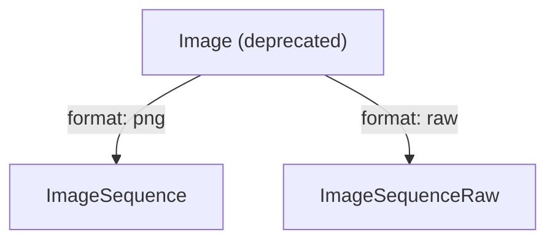
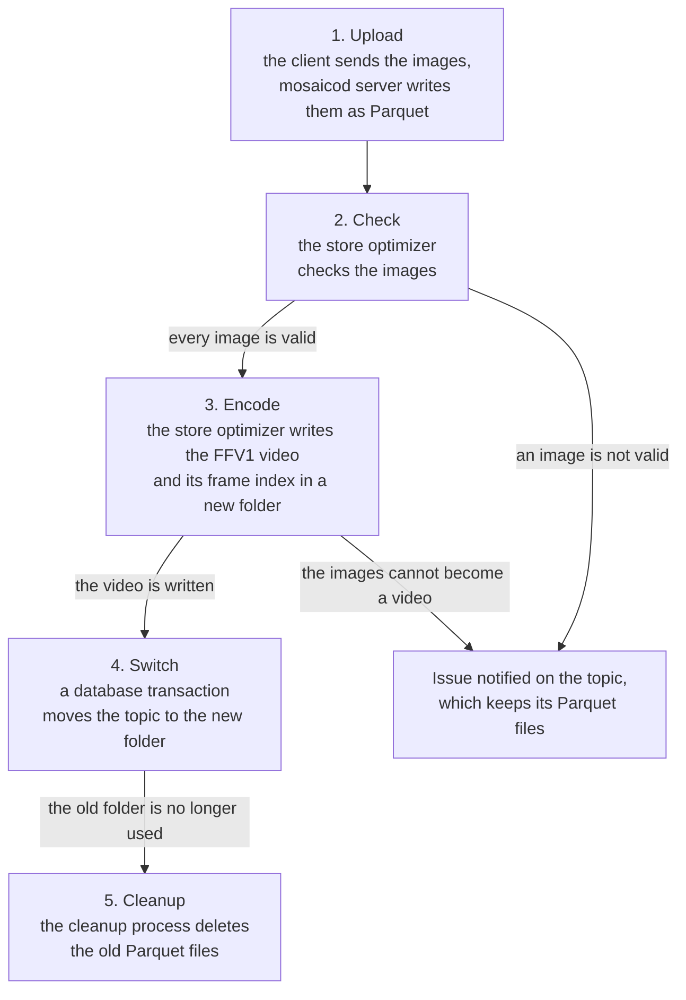
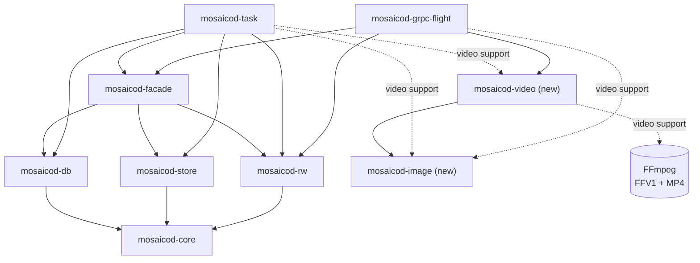

# Image sequences

## Summary

This RFC adds two ontologies to Mosaico, which store the images of a camera
on `mosaicod` together with the time each image was captured. Each ontology
has its own serialization format:

- `ImageSequence`: PNG images, compressed losslessly.
- `ImageSequenceRaw`: raw images, as a camera driver writes them. For
  example, the images of a ROS bag.

Their main goal is to replace the `Image` ontology, which becomes deprecated
for the reasons explained in the Motivation. The `CompressedImage` ontology,
for lossy images and video streams, is not affected by these changes.

The client uploads the images to `mosaicod` as they are. Later, the store
optimizer checks the content of the images and then, if it is possible, it
turns the whole sequence into a lossless FFV1 video.

The video holds only the pixels of the images, so everything else the client
uploaded is saved in a Parquet file next to it, called the **frame index**.
The frame index has a row for each image, with its timestamps and its other
fields: the coordinate frame of the camera and the number of the image, both
taken from the ROS header, and any other field the client added to the ontology.
For a raw image, the row also describes how its bytes are laid out, so that
the video and the frame index together can rebuild every image: a raw image
byte for byte, and a PNG pixel for pixel.

The choice of turning images into a video comes from the fact that a video
encoded with FFV1 keeps every pixel exactly and takes less space than the
original images, as shown by the [file size graph][filesize] of the
[ffv1-analysis PoC][ffv1-analysis].

The client sends the image sequence using one of the two ontologies, and it
is saved in the object store as a topic, whose data lives in a folder. The
store optimizer does not modify the original folder of the topic, which
holds the images, but it writes the video and the frame index into a new
folder. Once the video is successfully written in the object store, the
database swaps the topic to the new folder in a single transaction, and from
then on the topic contains the video instead of the images. The original
folder containing the images is not deleted immediately, but a separate
cleanup process deletes it after a retention period of 24 hours by default,
as it already does for the other folders that are no longer used.

A client can read back an image sequence in two ways:

- **The images**, which come back as they were uploaded, with all their
  fields and in recording order. A raw image comes back identical, byte for
  byte. A PNG, instead, comes back as the same image, pixel for pixel: once
  decoded, every pixel has exactly the value it had in the uploaded PNG.
  However, the bytes of the file can differ, because the server writes a
  **new PNG** from the pixels of the video, and it can use different
  optimization settings from those of the original file.
- **The video**, as a whole or only some of its seconds. The video comes
  back cut into segments of **1s**, in MPEG-DASH, a standard streaming
  format. Each segment starts with a complete image, so it can be played
  without the previous segments, and it comes with the exact recording and
  capture times of each of its images.

## Motivation

Robots and vehicles record long sequences of camera images, which are often
the largest part of a recording and so of its storage cost.

The `Image` ontology was created to store the images of ROS bags, but it has
three problems that prevent the server from turning a topic into a video:

- **One ontology for different things.** A message holds either raw pixels
  or a PNG, depending on its `format` field, so the kind of image is not
  fixed by the ontology but can change from message to message. A topic can
  then mix raw images and PNGs, and the server has no guarantee about what
  it holds: it has to look at every message, and to handle each kind of
  image differently, both to build the video and to give the images back as
  they were uploaded.
- **No capture time.** The time the camera took the image is in an
  **optional** header, and without it the server cannot order the frames of
  a video.
- **Images compressed one by one.** In the Parquet files, each image is a
  separate value, compressed with a general purpose algorithm that knows
  nothing about images. A PNG is already compressed, so it does not shrink,
  and raw pixels shrink only a little, so the stored images take almost as
  much space as the original ones.

The new ontologies solve these problems, because each of them holds a single
kind of image, and every image has its capture time. So the server can check
the images of a topic and then turn them into a single video, without losing
any data.

For this reason, we introduced two ontologies that split `Image` by kind of
image:

- `ImageSequence` for PNGs, which are already compressed when they reach
  the server.
- `ImageSequenceRaw` for raw images, which are the largest data, and so the
  ones that the video compresses the most. The ontology keeps every field of
  a ROS image message, so that a ROS bag can be rebuilt exactly.



Each ontology has **only** the fields its kind of image needs, so that every
message fully describes its image. All of them are required, except the two
that come from the ROS header, because not every source fills them:

- `frame_id`, the coordinate frame of the camera.
- `sample_counter`, the number of the image, which exists only in ROS 1,
  where it is the `seq` field of the header.

The capture time, instead, which in ROS is the `stamp` field of the header,
is **always** required. In the new ontologies it is a field of its own, called
`capture_timestamp_ns`, while in `Image` it is inside the optional header.

## Design

### The data flow, from client to server

An image sequence goes through five phases. Only the first one involves the
client and the server, `mosaicod server`, while the others run later in two
separate processes of the same binary: `mosaicod store-optimizer` and
`mosaicod cleanup`.



1. **Upload.** The client creates a topic with one of the two ontologies
   and pushes one message per image, which `mosaicod server` writes into
   Parquet files. The server **does not check the images**, because
   decoding them would make the upload too slow.
2. **Check.** Later, the **store optimizer** takes the complete topics that
   are not optimized yet, and if the topic is an `ImageSequence`, it checks
   every image without decoding it:
   - the `format` field of the image is not empty, and its value is a
     format the server can turn into a video, which currently is only `png`
   - the format is the same for all the images of the topic
   - the bytes of the image really are an image of the format declared in
     its `format` field

   If the topic is an `ImageSequenceRaw`, instead, the raw images cannot be
   checked without decoding them, so they are checked in the next Encode
   phase. While they are decoded, their bytes must match the size and the
   stride given by their `width`, `height` and `stride` fields.
3. **Encode.** The optimizer decodes each image once and then encodes the
   images into a lossless **FFV1 video**. The video and its frame index are
   written in a new folder of the store, while the topic still uses its
   original folder.
4. **Switch.** Once the video is written, a single database transaction
   switches the topic to the new folder, so that from then on the topic
   contains the video instead of the images.
5. **Cleanup.** The old folder with the Parquet files is no longer used, so
   the **cleanup** marks it and deletes it after the retention period.

### The ontologies

In both ontologies each message is one image. As in every ontology, the
message has `timestamp_ns`, which is when the image was **recorded**.

`ImageSequence`, PNG images:

| Field | Type | Null | Description |
|---|---|---|---|
| `format` | `string` | no | The encoding of the image. Only `png`. |
| `capture_timestamp_ns` | `int64` | no | When the camera **took** the image, in nanoseconds since the Unix epoch. |
| `frame_id` | `string` | yes | The coordinate frame of the camera, from the ROS header. |
| `sample_counter` | `uint64` | yes | The number of the image, from the ROS 1 header (`seq`). |
| `data` | `binary` | no | The PNG. |

`ImageSequenceRaw`, raw images:

| Field | Type | Null | Description |
|---|---|---|---|
| `capture_timestamp_ns` | `int64` | no | When the camera **took** the image, in nanoseconds since the Unix epoch. |
| `width` | `uint32` | no | Pixels per row. |
| `height` | `uint32` | no | Rows. |
| `stride` | `uint32` | no | Bytes per row, padding included. |
| `encoding` | `string` | no | The pixel encoding, as in ROS: `mono8`, `bgr8`, `16UC1`... |
| `is_bigendian` | `bool` | yes | Whether 16-bit samples are big-endian. If null, it is read as `false`, so the samples are little-endian, but it is kept null in the stored data. |
| `frame_id` | `string` | yes | The coordinate frame of the camera, from the ROS header. |
| `sample_counter` | `uint64` | yes | The number of the image, from the ROS 1 header (`seq`). |
| `data` | `binary` | no | The pixels, `stride × height` bytes. |

Queries can filter on every field except `data`.

Only **lossless** images are considered by these ontologies, so that the
server stores exactly what the camera produced. Lossy images, such as JPEG,
are handled by the `CompressedImage` ontology.

### ROS images

In ROS, a raw camera image is a message of type `sensor_msgs/Image`. The ROS
bridge turns each of these messages into an `ImageSequenceRaw`, and on
export it turns it back into the same message:

| ROS | `ImageSequenceRaw` |
|---|---|
| `header.stamp` | `capture_timestamp_ns` |
| `header.frame_id` | `frame_id`, null if empty |
| `header.seq` (ROS 1 only) | `sample_counter` |
| `width`, `height`, `step` | `width`, `height`, `stride` |
| `encoding`, `is_bigendian` | `encoding`, `is_bigendian` |
| `data` | `data` |

An image whose stamp is zero has no capture time, so it is not translated
(see the [open questions about ROS images][ros-open-questions]).

### `Image` is deprecated

`Image` topics can still be written and read, but creating one for writing
warns the user to use `ImageSequenceRaw` instead. The `Image` topics already
stored are still exported to ROS.

### The serialization formats

`ImageSequence` and `ImageSequenceRaw` are two new serialization formats. On
disk they are Parquet files, like the other formats, and only the settings
of each column change:

| Column | Compression | Statistics |
|---|---|---|
| `timestamp_ns` | none | page statistics and a bloom filter |
| `capture_timestamp_ns` | ZSTD | page statistics |
| `format`, `frame_id`, and for raw images `width`, `height`, `stride`, `encoding`, `is_bigendian` | dictionary, then ZSTD | page statistics |
| `data` of a PNG | none, it is already compressed | none |
| `data` of a raw image | ZSTD, fast | none |
| any other column | none | none |

The formats find the columns by their names, so the fields of the
ontologies must not be renamed.

### The issues

When the optimizer finds a problem, it **leaves the topic as the client sent
it**, so the topic stays readable, and it writes the problem in an `error`
notification on the topic: `store optimizer/<issue>: <details>`. The issues
are:

- `format_mismatch`: a PNG has no format, an unsupported one, or one
  different from the other images.
- `undecodable`: a PNG is not valid or its pixels are corrupted, or the
  bytes of a raw image do not match its size and stride.
- `unsupported`: the images cannot become a video without losing
  information. For example, the images have different sizes, a required
  field is missing, a raw encoding cannot be held by the video yet, or the
  topic has no images. The same happens when a column has a name that the
  frame index uses for itself: `frame`, `video_timestamp_us`,
  `fragment_offset` or `fragment_size`. Any other column the client adds is
  kept in the frame index.
- `failed`: something outside the data failed, such as the encoder, the
  store, the network or the database.

The first three issues depend on the data, so the optimization of the topic
ends and it is never tried again. A `failed` topic, instead, is tried again
at the next run, with a notification at every attempt.

### The video

After the optimizer, the topic is no longer stored as Parquet files, and its
folder holds the video, `video.mp4`, and its frame index,
`timestamps.parquet`.

The video is encoded with FFV1, the lossless codec of FFmpeg, in a
fragmented MP4 file, which is a header followed by one fragment per image.
The fragments follow the capture order, by `capture_timestamp_ns` and then
by `timestamp_ns` for equal capture times. Every frame is a keyframe, so
each fragment can be decoded on its own.

Each frame is placed at its capture time, in microseconds from the first
frame and rounded. Two frames cannot share a time, so a frame that would
land on the previous one is moved 1 µs after it. For this reason the video
times are approximate, and they are used only to place the frames in the
video and to cut it into segments. The exact timestamps, in nanoseconds, are
in the frame index, which is used to filter, sort and read back the images,
and every segment carries the exact timestamps of its frames.

The frames keep exactly the pixels of the images, without any color
conversion, so a frame is gray, gray with alpha, RGB or RGBA, of 8 or 16
bits.

Raw images can become a video in these encodings:

| Encoding | Frame |
|---|---|
| `mono8`, `8UC1`, 8-bit Bayer | gray, 8 bits |
| `mono16`, `16UC1`, `16SC1`, 16-bit Bayer | gray, 16 bits |
| `rgb8`, `bgr8`, `8UC3`, `rgba8`, `bgra8`, `8UC4` | RGB or RGBA, 8 bits |
| `rgb16`, `bgr16`, `16UC3`, `rgba16`, `bgra16`, `16UC4` | RGB or RGBA, 16 bits |

BGR pixels are swapped into RGB, and back when they are read. Big-endian
samples are read in their byte order and written back in it. The row
padding must be zero, and it is written back as zero.

The **frame index** is a Parquet file with one row per frame. The row holds
where the fragment of the frame is in the video and its time in the video,
together with every column of the image except `data`, as it was uploaded
and including the columns the client added. The file also keeps the schema
the images were uploaded with and its metadata. An image is then read back
as its row, with its frame decoded as `data`.

### Reading back

The client chooses what to read:

- **The images**, the default, which come back with the schema they were
  uploaded with and sorted by `timestamp_ns`. As for any topic, a time range
  keeps the images whose `timestamp_ns` is in it. Once the topic is a video,
  raw images come back byte for byte, while PNGs come back pixel for pixel,
  because the server encodes them again and so their bytes can differ.
- **The video**, as MPEG-DASH, which is a manifest, an initialization
  segment and one media segment per second of video. Every segment starts
  with a keyframe. With no interval, every segment comes back, and together
  with the initialization segment they form the whole video.

An interval asks for the seconds `[start, end)` of the video, where second 0
starts at the first frame. The request fails if the interval does not start
before its end, if it ends after the video, or if it comes with a time
range. A second with no frames, during a pause of the capture, has no
segment.

The segments are read from the store as byte ranges of the video, without
FFmpeg, and each of them comes with the exact timestamps of its frames.
Asking for the video fails until the topic is a video.

FFV1 has no registered codec name in MP4 and DASH, so FFmpeg and the tools
built on it read the segments, but browsers and most DASH players do not.

### The protocol

The client chooses what to read with a new field, `image_sequence`, which is
added to `TicketTopic` and to `GetFlightInfoCmd`:

```proto
message ImageSequenceRequest {
  oneof view {
    ImagesView images = 1; // the default, when the field is not set
    VideoView video = 2;
  }
}

message ImagesView {}

message VideoView {
  VideoInterval interval = 1; // every second of the video if not set
}

message VideoInterval {
  uint32 start_s = 1;
  uint32 end_s = 2;
}
```

In a sequence, the topics that are not image sequences ignore the field,
while for a single topic that is not an image sequence, asking for anything
but the images fails.

The images come back with the schema they were uploaded with. The video,
instead, comes back as the files of the DASH stream, cut into pieces, with
one row per piece:

| Column | Type | Description |
|---|---|---|
| `name` | `string` | The file, as the manifest names it: `manifest.mpd`, `init.mp4`, `segment-<start_us>.m4s`. |
| `segment` | `uint64` | The number of a media segment: its second of video. |
| `start_us`, `duration_us` | `int64` | The window of a media segment, in microseconds of video. |
| `offset` | `uint64` | Where the piece starts in its file. |
| `data` | `binary` | The piece. |
| `last` | `bool` | Whether it is the last piece of its file. |
| `timestamp_ns`, `capture_timestamp_ns`, `video_timestamp_us` | `list<int64>` | The timestamps of each frame of a media segment, on its first piece. |

The columns of a media segment are null for the manifest and the
initialization segment. The metadata of the schema describes the whole
video:

- `mosaico:content_type`: `video/mp4`.
- `mosaico:codec`: `ffv1`.
- `mosaico:frames`: the number of frames.
- `mosaico:timescale`: `1000000`, so the times are in microseconds.
- `mosaico:capture_start_ns`: the capture time of the first frame, from
  which the times of the video start.

### Deployment

FFmpeg is needed only to encode the videos and to decode them back into
images, so `mosaicod` can be built in three ways:

- **Without video support**, the default, which needs no FFmpeg. The server
  reads back the video and the images of the topics that are not a video
  yet, while the store optimizer optimizes every other topic and leaves the
  image sequences in the queue for an optimizer with video support.
- **With video support**, the `video` feature, where `mosaicod` links the
  FFmpeg libraries of the system, which must be installed where it runs.
- **With video support, static**, the `video-static` feature, where FFmpeg,
  built by `scripts/install-ffmpeg`, is linked inside `mosaicod`, so it
  needs nothing else to run. This is the `mosaicod-optimizer` Docker image.

So the store optimizer can run on a machine with FFmpeg and the server on
another one. When it starts, the optimizer checks that its FFmpeg has the
FFV1 codec and the MP4 format, and if it does not, it logs an error and
leaves the image sequences in the queue.

By default, both the store optimizer and the cleanup run once and then
exit, but they can also run in a loop. Several optimizers can run at the
same time, because each topic is leased to only one of them.

### The `mosaicod` crates

Two crates are new, `mosaicod-image` and `mosaicod-video`, while the others
already exist and are extended. An arrow `A --> B` means "A uses B", and a
dashed arrow means "A uses B only with video support". Only the crates
involved with image sequences are shown. The server always uses
`mosaicod-video`, because it finds the fragments of a video without FFmpeg.



What each crate does for image sequences:

- `mosaicod-core`: the two new formats and the issues.
- `mosaicod-marshal`: maps the formats and the reading options of the
  protocol.
- `mosaicod-rw`: the column settings of the two formats, and the layout of
  the video and of its frame index, which the server and the optimizer
  share.
- `mosaicod-store`: writes a local file to the store in parts, and reads
  byte ranges of a file.
- `mosaicod-db`: the queue of the optimizer, which can skip the image
  sequences, and the notification of the issues.
- `mosaicod-facade`: finds the video of a topic.
- `mosaicod-image` (new, pure Rust): checks and decodes PNGs, and turns raw
  images into samples and then back into the same bytes.
- `mosaicod-video` (new): encodes images into an FFV1 video and decodes it
  with FFmpeg, and finds the fragments of a video without FFmpeg.
- `mosaicod-task`: the image sequence path of the store optimizer, which
  checks, encodes and writes the video and then switches the topic to it.
- `mosaicod-grpc-flight`: reads back the images, from the Parquet files or
  from the video, and the video as MPEG-DASH segments.

### The Python SDK

The SDK adds the two ontologies and their serialization formats, deprecates
`Image`, and translates ROS images into `ImageSequenceRaw`.

## Drawbacks

- **The video takes more space than a lossy one.** FFV1 keeps every pixel,
  so the 60 8K images of the PoC take 1,279 MiB, which is 1.5 times less
  than as PNG, while a lossy AV1 video of them takes about 12 MiB (see the
  alternatives).
- **PNG files are not kept.** The video keeps their pixels, but after the
  retention period the rest of the file, which is its compression and its
  metadata, is lost. Raw images, instead, come back byte for byte.
- **Bad images are found late.** The upload accepts any bytes, so the client
  learns about a bad image only after the optimizer has run.
- **A new dependency for the optimizer.** Encoding needs FFmpeg, which is
  built from source for the `mosaicod-optimizer` image.
- **Encoding takes resources.** It takes CPU time, mostly to decode the
  images, and local disk space on the machine of the optimizer, one topic at
  a time.
- **Few players read the video.** FFmpeg and the tools built on it read FFV1
  in MP4 and DASH, but browsers do not.
- **Some ROS images are refused.** A ROS image whose stamp is zero cannot be
  translated. With the default error policy of a topic, `raise`, the
  ingestion of the bag stops, while with `ignore` the image is dropped and
  the others are ingested.

## Alternatives

- **Keep `Image`.** A topic can mix raw and PNG images, which cannot become
  one video, and its capture time is optional, so the server cannot order
  the frames.
- **One ontology for PNG and raw images.** The layout fields of raw images
  would be null for every PNG, and the kind of each image would again
  depend on a field, so a topic could mix both kinds.
- **Keep the ROS header as it is.** Its stamp would repeat the capture time,
  and the header would carry only two optional fields.
- **Keep the images in Parquet.** The formats do this until the optimizer
  runs. It is simple and it keeps the original bytes, but every image is
  compressed on its own, so PNGs do not shrink, and a client that wants a
  video has to encode it itself.
- **Check the images during the upload.** Decoding every image while it is
  uploaded makes the upload too slow for long, high-resolution sequences.
- **Accept lossy images, such as JPEG.** Each image has already lost
  information, and a lossless video of the decoded images would take much
  more space than the JPEGs themselves.
- **A lossy video, such as AV1.** It takes much less space: the [file size
  graph][av1-filesize] of the image-sequence PoC shows the same 60 8K images
  in 12 MiB with SVT-AV1, which is 159 times less than as PNG. But it loses
  information, because it is visually lossless and not lossless: 16-bit
  images become 10-bit frames, the alpha channel is dropped, and the colors
  go through a conversion.
- **A Matroska file instead of MP4.** Its frames cannot be cut into DASH
  segments that are read as byte ranges of the file.
- **A CSV frame index.** It needs another library and keeps only text, while
  Parquet is already used everywhere in `mosaicod` and keeps every type.

## Open questions

Each question is followed by a proposal, when there is one, as a starting
point for the discussion.

The questions about the design must be answered before this RFC is
approved, while the questions in [Left to the
implementation][implementation] can only be answered while implementing, so
they can stay open.

### When the optimizer runs

- **Question:** A topic waits until the next run of the optimizer, which can
  be much later than the upload, or never. Should the optimizer start as
  soon as an upload is finalized?
  - **Proposal:** the server notifies the database when an upload is
    finalized, and then the optimizer, which is always running, starts right
    away.
- **Question:** Should `mosaicod server` start the optimizer itself?
  - **Proposal:** no. Keep it separate, so that encoding does not take the
    CPU of the server and can run on another machine.

### The optimizer

- **Question:** A `failed` topic is tried again at every run, forever, with a
  new notification each time. Should the retries stop at some point?
  - **Proposal:** after a number of attempts, turn the issue into a
    permanent one.
- **Question:** If an optimizer crashes while encoding, its topic stays
  leased for 7 days. Is that too long for image sequences?
  - **Proposal:** renew the lease while encoding, and make it shorter.
- **Question:** The images are decoded in memory without a size limit, but a
  PNG can declare a huge image. Should there be a limit?
  - **Proposal:** a maximum number of pixels per image, in the settings.

### Loss of information

- **Question:** PNG files are deleted after the retention period. Should
  they be kept somewhere?
- **Question:** A PNG is read back as a new file, written from the pixels of
  the video, so it loses the metadata of the original file. This includes
  text, dates and physical size, but also the chunks that tell how to
  display the colors (`gAMA`, `iCCP`, `sRGB`, `cHRM`), which can change how
  the image looks. Besides, a PNG with a palette, with transparency in a
  `tRNS` chunk, or with fewer than 8 bits per sample comes back expanded:
  a palette becomes RGB or RGBA, a `tRNS` chunk becomes an alpha channel,
  and the samples become of 8 bits. The colors are the same, but the layout
  of the file is not. Should the server keep these properties?
  - **Proposal:** keep the metadata chunks of each PNG in the frame index,
    and write them back into the new file, together with the original
    palette, transparency and bit depth. The compression settings, instead,
    cannot be kept, because a PNG does not record them, so the bytes of the
    file can still differ.
- **Question:** Until the retention period ends, an image sequence takes the
  space of both the images and the video. Are 24 hours right?
- **Question:** Should a topic also get a lossy video, such as AV1, for the
  clients that only look at the images?
  - **Proposal:** not now. Add it later as a second video, when users need
    it.

### Queries

- **Question:** The catalog queries and the time range info of a topic read
  its files as Parquet, but once the topic is a video, its files are the
  video and the frame index. How do they work on an optimized topic?
  - **Proposal:** read the frame index instead, because it has every column
    except the images.
- **Question:** The images are filtered by the time they were recorded, while
  the video is filtered by seconds of capture. Are two timelines confusing?
  - **Proposal:** keep both, and also let the images be filtered by capture
    time. This changes the protocol, because `ImagesView` gets a capture
    time range, `[start, end)` in nanoseconds, which cannot come with the
    time range of the ticket.

### Reading back

- **Question:** Reading the images of a video needs a server with video
  support, which the default `mosaicod` image does not have. Today, what a
  request for the images returns depends on both the server and the topic:

  | Topic | Server without video support | Server with video support |
  |---|---|---|
  | Not optimized yet | the images, from the Parquet files | the images, from the Parquet files |
  | Already a video | an error: only the video can be read | the images, decoded from the video |

  The error is not a rare case, because the video is made by the
  `mosaicod-optimizer` image, while the default server image has no FFmpeg
  to decode it. Should every server have video support, so that the images
  can be read on every server?
  - **Proposal:** yes. The server image links FFmpeg too, as the optimizer
    image does.
- **Question:** At every read of the images, the server decodes the video
  and encodes the PNGs again. Can many clients read at once?
  - **Proposal:** limit how many reads are decoded at the same time.
- **Question:** Segments last one second. Is that right for every camera,
  from one image every few seconds to hundreds per second?
- **Question:** The Python SDK cannot read the video yet. What should it
  offer?
  - **Proposal:** read the segments of an interval, and then decode them
    into images with PyAV.

### ROS images

- **Question:** A ROS image whose stamp is zero has no capture time, because
  its driver did not fill it, and the time it was recorded in the bag is not
  its capture time. What should we do with these images? The options are:
  - refuse them, as now;
  - use the time they were recorded in the bag, which is simple, but the
    capture time is then wrong and nothing tells it apart from a right one;
  - make `capture_timestamp_ns` optional, but then the video can no longer
    order the frames, so the topic cannot become a video.
  - **Proposal:** keep refusing them, but the ROS bridge skips each one with
    a warning, whatever the error policy of the topic, instead of stopping
    the ingestion of the bag by default. The report of the ingestion counts
    the skipped images.
- **Question:** A ROS `CompressedImage` in PNG is lossless. Should it become
  an `ImageSequence`?
  - **Proposal:** yes, when every image of the topic is a PNG.
- **Question:** An `ImageSequence` cannot be exported to ROS. Should it?
  - **Proposal:** export it as a `CompressedImage` in PNG.

### `Image`

- **Question:** What happens to the `Image` topics already stored? Should
  they be converted?
  - **Proposal:** a command converts the raw ones into `ImageSequenceRaw`,
    so that they become videos too.
- **Question:** When is `Image` removed?

### Checking the images

- **Question:** Should the upload reject bad images right away?
  - **Proposal:** the upload runs only the cheap checks, such as a missing
    or unsupported format, while decoding stays in the optimizer.
- **Question:** A topic with an issue is never optimized again. How is it
  optimized after a version that supports it?
  - **Proposal:** a `mosaicod` command queues these topics again.
- **Question:** The `format` of PNGs is the same in every message. Should it
  be declared once per topic?
  - **Proposal:** declare it in the metadata of the topic.

### Supported images

- **Question:** Image sequences accept only lossless images, so JPEG images,
  which are lossy, stay in `CompressedImage`. Should image sequences accept
  JPEG images too, so that they also get a capture time and a frame index?
  A lossless video of the decoded JPEGs would take much more space than the
  JPEGs themselves (see the alternatives), so the options are:
  - keep the JPEG images as they are, without a video;
  - put the JPEG images, without decoding them, into a Motion JPEG video,
    which keeps every image byte for byte, but which browsers cannot play;
  - encode them into a lossy video, which loses more information at every
    encoding.
  - **Proposal:** not now. Image sequences accept only lossless images, and
    JPEG can be added later as a new format, if users need it.
- **Question:** Each image is one message, and a message cannot be split
  inside an image, so every image must fit in a single gRPC message. The
  server accepts incoming messages of up to 50 MiB by default
  (`MOSAICOD_GRPC_MAX_DECODE_MESSAGE_SIZE`), which can be raised to at most
  512 MiB. Large raw images do not fit with the default limit:

  | Image | Size |
  |---|---|
  | 4K `rgb8` | 23.7 MiB |
  | 4K `rgba16` | 63.3 MiB |
  | 8K `mono8` | 31.6 MiB |
  | 8K `rgb8` | 94.9 MiB |
  | 8K `rgba16` | 253.1 MiB |

  How should these images be uploaded?
  - **Proposal:** for now, document the limit and raise it for the servers
    that receive large images, which covers images of up to 512 MiB. If
    larger images are needed, split each image into several messages, but
    this changes the ontology and the protocol.
- **Question:** Images of different sizes are `unsupported`. Do users change
  resolution in the middle of a recording?
  - **Proposal:** if they do, start a new video at each change.
- **Question:** YUV raw images (`yuv422`, `uyvy`, `yuyv`) are `unsupported`.
  Should they become videos too?
  - **Proposal:** yes, because their samples can be rearranged into planes,
    which FFV1 encodes losslessly.
- **Question:** Floating point depth images (`32FC1`) are `unsupported`,
  because FFV1 has no single channel of 32-bit floats. Should they become
  videos?
  - **Proposal:** split each float into two 16-bit channels, if users need
    it.
- **Question:** Raw images whose row padding is not zero are `unsupported`,
  because the video loses the padding. Should they become videos too?
  - **Proposal:** keep the padding apart, for example in the frame index.

### Left to the implementation

These questions can only be answered by measuring or testing the
implementation, or they change only the internals of `mosaicod` and not what
a client sees, so they can stay open after this RFC is approved.

- **Question:** A segment is read whole in memory and then cut into pieces,
  but a second of 8K video at 60 fps is more than a gigabyte. Should a
  segment be streamed instead?
  - **Proposal:** stream the fragments of a segment one at a time. The
    protocol already sends a segment in pieces, with their `offset` and
    `last`, so the clients do not change.
- **Question:** Do the queries that filter on the fields of an image
  sequence still work once the topic is a video?
  - **Proposal:** add an integration test that queries an optimized topic.
- **Question:** How long does a long, high-resolution sequence take to
  encode, and does it delay the other topics in the queue?
  - **Proposal:** measure it on real recordings, and run more optimizers
    when needed.
- **Question:** How much local disk does the optimizer need?
  - **Proposal:** document it: at least the size of the largest video it
    encodes.
- **Question:** Each image gets its own fragment, with its own header. For
  small images, can the video take more space than the images?
  - **Proposal:** measure it, and keep the images in Parquet when it does.
- **Question:** The frame index has no version. How can its layout change
  later?
  - **Proposal:** write a version in its metadata.
- **Question:** Long gaps between frames rely on the internals of the MP4
  writer of FFmpeg. Will they still work with the next versions of FFmpeg?
  - **Proposal:** keep the test of long gaps, and run it at every upgrade of
    FFmpeg.
- **Question:** The Parquet library builds a ZSTD level only at runtime,
  with an error to handle. Can it build a valid level without one?
  - **Proposal:** propose it upstream, to Apache Arrow.

[implementation]: #left-to-the-implementation
[ros-open-questions]: #ros-images-1
[ffv1-analysis]: https://github.com/mosaico-labs/video-pocs/tree/main/ffv1-analysis
[filesize]: https://github.com/mosaico-labs/video-pocs/blob/main/ffv1-analysis/results/reference/ffv1/filesize-input.svg
[av1-filesize]: https://github.com/mosaico-labs/video-pocs/blob/main/image-sequence/video-results/regular/batch_060/preset_5_crf_18/filesize-comparison/filesize-comparison.svg
