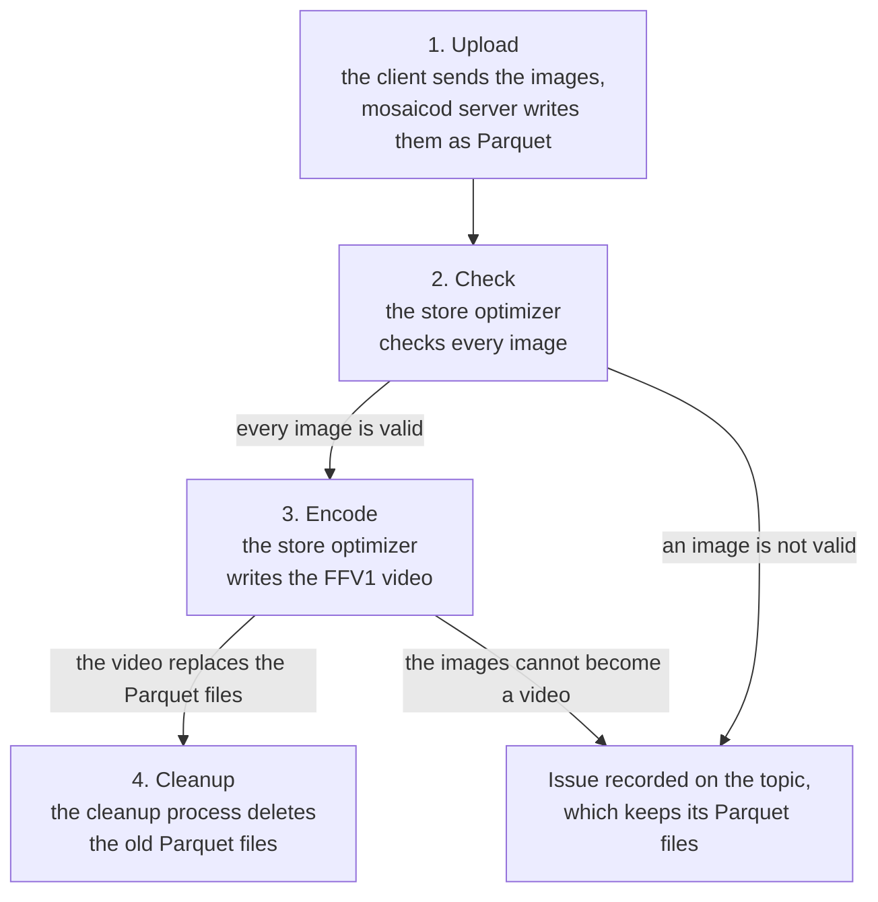
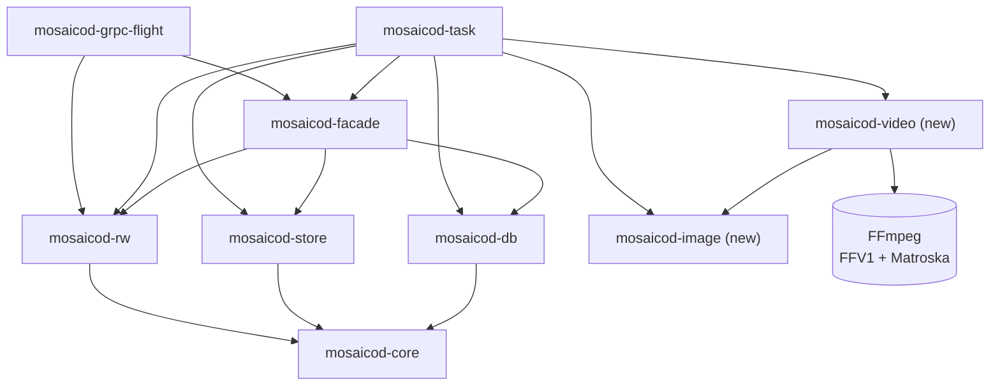

# Image sequences

## Summary

Add an `ImageSequence` ontology and serialization format to Mosaico, to
store the images of a camera, each with the time it was captured. Only
lossless image formats are considered for now: PNG and TIFF are the first
ones supported.

The client uploads the images as they are. Later, the store optimizer
checks them and turns the whole sequence into a lossless FFV1 video, with
a file that keeps the exact timestamps of every frame.

The images are turned into a video because a video can be read back in
the ways described below, while FFV1 keeps every pixel of the images and
still takes less space than them, as shown by the
[file size graph][filesize] of the [ffv1-analysis PoC][ffv1-analysis]: a
sequence of 60 8K images (8192x4320) takes 1,931 MiB as PNG and 1,279 MiB
in FFV1, every pixel kept.

Since the video holds exactly the pixels of the images, `mosaicod` does
not keep the original images, only the video. However, the images are not
deleted right away: a separate cleanup process deletes them after a
retention period (24 hours by default), as it already does for the other
files the store no longer uses.

The video has one frame per image, so the topic can be read back in three
ways:

- as a whole video
- as a series of independent videos that can be merged into a single one
- as the image sequence, extracting from each frame exactly the image it
  was made from

> [!NOTE]
> This RFC designs how image sequences are stored as Parquet files and
> turned into videos. Reading back a topic that has become a video, in any
> of the three ways above, is not designed yet.

## Motivation

Robots and vehicles record long sequences of camera images. Mosaico can
already store them, with the `Image` and `CompressedImage` ontologies:
both carry the time the image was recorded (the timestamp of the message)
and, optionally, the time the camera took it (in their header). But
nothing tells the server that a topic is a sequence of images it can
handle as a whole:

- `Image` and `CompressedImage` accept raw buffers, lossy formats such as
  JPEG, and video streams such as H.264 that depend on the previous
  frames, and the capture time is optional. So the server cannot turn
  their topics into a video without losing information or getting the
  order of the frames wrong.
- Stored as rows of Parquet files, the images are separate blobs: each
  one is compressed on its own (a PNG, already compressed, does not get
  any smaller), and a client can only get them back one by one.
- There is no way to get the images of a camera back as a video, to watch
  them or to give them to the tools that take videos.

`ImageSequence` is that guarantee: every message is one self-contained
image, all of a topic in the same lossless format, each with its capture
time. With it, the server can check the images and turn the whole topic
into one video that keeps them exactly.

This affects every user who records cameras with Mosaico: the images are
often the largest part of a recording, and so of its storage cost.

## Design

### The data flow, from client to server

An image sequence goes through four phases. Only the first one involves the
client and the server (`mosaicod server`). The others run later, in two
separate processes started with the same binary: `mosaicod store-optimizer`
and `mosaicod cleanup`.



1. **Upload.** The client creates a topic with the `ImageSequence` ontology
   and pushes one message per image. `mosaicod` writes the batches into
   Parquet files (the *chunks* of the topic) as they arrive, **without
   checking the images**: decoding them would make the upload too slow.
2. **Check.** Later, the **store optimizer** (`mosaicod store-optimizer`)
   takes the complete topics that are not optimized yet. A topic is queued
   as soon as its upload is finalized, but it is optimized only when the
   optimizer runs: by default it runs once and exits,
   so it must be started by hand or by a scheduler; with a positive
   `--time-interval` it runs in a loop, sleeping that many seconds between
   runs. Several optimizers can run at the same time: each topic is leased
   by one of them. For an image sequence it checks every image: the
   declared format is supported and the same for all the images, the bytes
   are really an image of that format, and the pixels can be decoded.
3. **Encode.** If all the images are right, the optimizer decodes them
   and encodes them into a lossless **FFV1 video** in a Matroska file
   (`video.mkv`). The exact timestamps of the frames go into
   `timestamps.csv`. Both are written in a new folder of the store, and
   the topic is switched to that folder in a single database transaction.
4. **Cleanup.** The old folder with the Parquet chunks is no longer
   referenced. The **cleanup** (`mosaicod cleanup`) marks it and, on a run
   after the retention period (`--retention-duration`, 24 hours by
   default), deletes it. Like the optimizer, by default it runs once and
   exits, or in a loop with a positive `--time-interval`.

When a phase finds a problem, the topic is **left as the client sent it**,
and the problem is recorded on the topic in the database, as one of these
issues with a message:

- `format_mismatch`: a format is missing, unsupported, different from the
  first image's, or does not match the bytes. Found in phase 2.
- `undecodable`: the bytes are not an image, or the pixels are corrupted.
  Found in phase 2.
- `unsupported`: the images are right but cannot become a video without
  losing information (different sizes, channels or bit depths, extra
  columns, a layout that cannot be decoded, no images). Found in phase 3.
- `failed`: something outside the data failed (encoder, store, network,
  database). The topic is tried again at the next run of the optimizer.

The first three depend on the data, so the topic is never tried again until
someone clears the issue.

### The ontology

The ontology and the serialization format have the same name,
`ImageSequence`, but they are different things:

- the **ontology** is the shape of each message, what the client sends
- the **serialization format** is how the server writes the messages on
  disk

Each message of the ontology is one image, with these fields:

| Field | Type | Description |
|---|---|---|
| `timestamp_ns` | `int64` | When the image was **recorded**, in nanoseconds since the Unix epoch. As in every ontology, it comes from the message wrapping the image. |
| `capture_timestamp_ns` | `int64` | When the camera **took** the image, in nanoseconds since the Unix epoch. Queries can filter on it. |
| `format` | `string` | The encoding of the image, `png` or `tiff`. It is the same for all the images of a topic. Queries can filter on it. |
| `data` | `binary` | The encoded image, the content of a `.png` or `.tiff` file. Queries cannot filter on it. |

Only **lossless** image formats are accepted, so that the server stores
exactly the images the camera produced, from the upload to the video. PNG
and TIFF are the first supported formats, other lossless formats can be
added later. Lossy formats, such as JPEG, are not accepted.

### The serialization format

`ImageSequence` is a new serialization format. On disk it is Parquet, like
the other formats: what changes are the settings of each column.

| Column | Compression | Statistics | Why |
|---|---|---|---|
| `timestamp_ns` | none | page statistics and a bloom filter | To find quickly the images of a time range. |
| `capture_timestamp_ns` | ZSTD level 5 | page statistics | To filter by capture time. |
| `format` | dictionary encoding, then ZSTD level 5 | page statistics | The value is the same in every row, so it takes almost no space. |
| `data` | ZSTD level 3 | none | Uncompressed TIFFs get smaller; PNGs are already compressed and stay about the same size. |
| any other column | none | none | |

The columns are found by their names, so the fields of the ontology must
not be renamed.

### The video

After the store optimizer, the topic is no longer Parquet:

```txt
tp_<id>/
├── metadata.json          copied from the old folder
└── data/
    ├── video.mkv          the images, FFV1 in a Matroska file
    └── timestamps.csv     the exact timestamps of every frame
```

The video is encoded with FFV1, FFmpeg's lossless video codec, in its
version 3, which checks each part (*slice*) of a frame with a CRC: a frame
is split into 16 slices, encoded and decoded in parallel. There is one
frame per image, in capture order, each at its capture time in
milliseconds.

FFV1 compresses every frame on its own, so any frame can be decoded
without the others, and it is **lossless**: every frame decodes back to
exactly the pixels of its image. The pixels are stored as the image holds
them, with no color conversion, so the channels, the alpha channel
included, and the bit depth are kept:

| Image | Frame |
|---|---|
| gray, 8 or 16 bits | gray, 8 or 16 bits |
| gray with alpha, 8 or 16 bits | gray and alpha, 8 or 16 bits |
| RGB, 8 or 16 bits | RGB, 8 or 16 bits |
| RGBA, 8 or 16 bits | RGBA, 8 or 16 bits |

The file is tagged with the first capture time and the format, color type
and bit depth of the source images. Matroska stores milliseconds, so
`timestamps.csv` keeps the nanoseconds:

```csv
frame,timestamp_ns,capture_timestamp_ns,video_timestamp_ms
0,1767225600000000000,1767225599990000000,0
1,1767225600033366667,1767225600023366667,33
```

### Reading back from the video

The video is not only a way to store the images: it is what an optimized
topic is read back from. Since the video has exactly one frame per image,
in capture order, and `timestamps.csv` gives the times of every frame, a
client can get:

- **the whole video**, `video.mkv` with its `timestamps.csv`;
- **a series of independent videos**, for example one per time range,
  each of them playable on its own and all of them mergeable into a single
  video;
- **the image sequence**, decoding each frame into exactly the pixels of
  its image, with the timestamps of `timestamps.csv`, so that the client
  gets back as many images as it sent.

How each of them is requested and produced is in the
[open questions][reading-back].

### The `mosaicod` crates

Two crates are new, `mosaicod-image` and `mosaicod-video`. The others
already exist and are extended. An arrow `A --> B` means "A uses B"; only
the crates involved with image sequences are shown.



What each crate does for image sequences:

- `mosaicod-core`: the shared types. Adds `Format::ImageSequence` and
  `OptimizationIssue` (`format_mismatch`, `undecodable`, `unsupported`,
  `failed`).
- `mosaicod-marshal`: maps the `FORMAT_IMAGE_SEQUENCE` value of the protocol
  to `Format::ImageSequence`.
- `mosaicod-rw`: reads and writes the Parquet chunks. Adds the column
  settings of the `ImageSequence` serialization format.
- `mosaicod-grpc-flight`: the `do_put` endpoint of the upload. It uses only
  `mosaicod-rw`, so it never looks inside the images.
- `mosaicod-db`: the PostgreSQL queries. Adds the `optimization_issue` and
  `optimization_issue_message` columns of `topic_t`, and the queries that
  record and clear them.
- `mosaicod-store`: the filesystem or S3 store. Adds
  `Store::write_from_file`, which uploads a local file in parts of 16 MiB
  (an S3 multipart upload), so the video is never held whole in memory.
- `mosaicod-image` (new, pure Rust): the supported lossless formats
  (`ImageFormat`: PNG, TIFF), the quick check of the structure of an image
  (`is_image`, `format_of`), and the decoding into samples (`decode`).
- `mosaicod-video` (new): encodes images into an FFV1 video in a Matroska
  file and decodes it back into the same images, with FFmpeg. The encoder
  and decoder are behind the `ffmpeg` feature, so the crate builds without
  FFmpeg when they are not needed.
- `mosaicod-task`: the background tasks. The store optimizer is split into
  steps shared by every topic (read, copy the metadata, complete the
  optimization), and gets an image sequence path
  (`store_optimizer/image_sequence.rs`) that checks, encodes, writes and
  switches the topic. It is the only crate that uses `mosaicod-image` and
  `mosaicod-video`.

Because `mosaicod-task` enables the `ffmpeg` feature, building `mosaicod`
needs FFmpeg with its FFV1 encoder and decoder and its Matroska muxer and
demuxer, which are part of FFmpeg itself: no other library is needed.
`scripts/install-ffmpeg` builds FFmpeg 9 with only those for the Docker
image, so that its libraries depend on nothing but the C library.

## Drawbacks

- **The video takes more space than a lossy one.** FFV1 keeps every pixel,
  so the 60 8K images of the PoC take 1,279 MiB, 1.5 times less than as
  PNG, while a lossy AV1 video of them takes about 12 MiB (see the
  alternatives).
- **The original files are not kept.** The video keeps the pixels of the
  images, but not the files the client sent: once the retention period is
  over, what was in a PNG or TIFF file besides its pixels (its compression,
  its metadata) is lost.
- **Bad images are found late.** The upload accepts any bytes, and the
  client learns about a bad image only after the optimizer has run.
- **A new system dependency.** Building and running `mosaicod` needs
  FFmpeg, built from source for the Docker image.
- **Encoding takes resources.** It takes CPU time, mostly to decode the
  images, and local disk space on the machine of the optimizer, one topic
  at a time.
- **Reading back is not designed yet.** Until it is, a topic that has
  become a video cannot be downloaded by a client.

## Alternatives

- **Keep the images in Parquet.** This is what the serialization format
  does before the optimizer runs. It is simple and keeps the original
  bytes, but every image is compressed on its own, PNGs do not get
  smaller, and a client that wants a video has to encode it itself.
- **Check the images during the upload.** Decoding every image while it
  is uploaded makes the upload too slow for long, high-resolution
  sequences. Only cheap checks could run there (see the open questions).
- **Encode the video during the upload.** It has the same problem as
  checking the images, and the Matroska muxer needs to seek back in the
  file to complete it, which a stream cannot do.
- **Accept lossy images, such as JPEG.** Each image has already lost
  information, and a lossless video of the decoded images would take much
  more space than the JPEGs themselves.
- **A lossy video, such as AV1.** It takes much less space: the
  [file size graph][av1-filesize] of the image-sequence PoC shows the same
  60 8K images in 12 MiB with SVT-AV1 at preset 5 and CRF 18, 159 times
  less than as PNG. But it loses information: it is visually lossless, not
  lossless, 16-bit images become 10-bit frames, the alpha channel is
  dropped, and the colors go through a conversion. It also needs the
  SVT-AV1 encoder and the dav1d decoder besides FFmpeg. It could come back
  as a second, compact version of the video (see the open questions).

## Open questions

Each question is followed by a proposal, when there is one, as a starting
point for the discussion.

The questions about the design must be answered before this RFC is
approved. The questions in [Left to the implementation][implementation]
can only be answered while implementing, and can stay open.

### When the optimizer runs

- **Question:** A topic waits until the next run of the optimizer, which can
  be much later than the upload, or never if nobody starts it. Should the
  optimizer start as soon as an upload is finalized?
  - **Proposal:** when a session is finalized, `mosaicod server` sends a
    PostgreSQL `NOTIFY`. The optimizer runs as a long-lived process that
    `LISTEN`s and starts optimizing right away, keeping `--time-interval`
    as a fallback for the notifications missed while it was down. This
    works across processes, and the leases already keep several optimizers
    from working on the same topic.
- **Question:** Should `mosaicod server` start the optimizer itself, or
  should it stay a separate process?
  - **Proposal:** keep it separate, so that encoding does not take the CPU
    of the server and can run on other machines. The deployment starts it
    as a long-lived process next to the server.
- **Question:** Even when started right away, encoding a long sequence
  takes time, so a topic is still Parquet for a while. What does a client
  get when it reads the topic in the meantime?
  - **Proposal:** reading back works the same in both states: the images as
    sent before the optimization, the decoded video after. The server also
    exposes the optimization state of a topic (pending, optimized, or its
    issue), so that a client that wants the video file itself can wait for
    it.

### Reading the data back

- **Question:** How does a client choose between the whole video, a
  series of independent videos, and the image sequence?
  - **Proposal:** reading the topic as usual returns the image sequence:
    the server decodes the frames and sends images of the source format
    (written in the tags of the video), so the client API does not change.
    A separate call returns the videos, the whole one or the ones of a
    time range, with their `timestamps.csv`.
- **Question:** If the server encodes the frames back into images, they
  have the same pixels as the ones the client sent, but not the same
  bytes: the compression and the metadata of the files may differ. Is
  that acceptable, and how do we tell the client?
  - **Proposal:** document it in the `ImageSequence` ontology, and use the
    optimization state of the topic to tell whether the images are the
    original files or encoded again from the video.
- **Question:** The video is in capture order, while the topic is indexed
  by `timestamp_ns`. When the two orders differ, in which order are the
  images read back?
  - **Proposal:** in `timestamp_ns` order, like every other topic, using
    `timestamps.csv` to find the frame of each row.
- **Question:** A long recording becomes a single video. How is a time
  range read without reading the whole file?
  - **Proposal:** every FFV1 frame can be decoded on its own, so find the
    frames of the range in `timestamps.csv` and read only them, through
    the index of the frames that Matroska keeps. If that is not enough,
    split long sequences into segments (see [MPEG-DASH][mpeg-dash]).
- **Question:** How are the independent videos made so that they can be
  merged into a single video?
  - **Proposal:** every FFV1 frame stands on its own, so any run of frames
    is a video of its own. Videos of the same size, channels and bit depth
    can be joined without encoding them again, and their `timestamps.csv`
    files concatenated.

### MPEG-DASH

MPEG-DASH is a standard way to split a video into segments, listed with
their times in a manifest, so that a client fetches only the segments it
needs. Here it would be used only to get segments and read the data back,
not to play the video in a browser.

A first test, with FFmpeg 9.0.2 on the FFV1 video of 8K RGBA images:
FFmpeg's DASH muxer writes a manifest and segments in fragmented MP4, and
the frames read back from the segments are byte for byte the ones of the
original PNGs. WebM segments, the other kind DASH uses, cannot hold FFV1.

- **Question:** Should an image sequence be stored as DASH segments, with
  their manifest, instead of a single `video.mkv`?
  - **Proposal:** yes, if reading time ranges from a single file is not
    enough: the optimizer writes the segments and the manifest, so that a
    read needs no repackaging, and the whole video is the segments joined.
- **Question:** How long should a segment be? Short segments let a client
  fetch only what it needs, but mean more files and more requests to the
  store.
  - **Proposal:** cut the segments by size, close to the size of the
    Parquet chunks (`--max-chunk-size`), since every frame can start a
    segment. Measure it on real recordings.
- **Question:** FFV1 in MP4 is FFmpeg's own mapping: FFV1 is not a codec
  registered for MP4, and the manifest has no codec string for it. Only
  readers built on FFmpeg can read the segments. Is that acceptable?
  - **Proposal:** yes: `mosaicod` reads them with FFmpeg, and the Python
    SDK can with PyAV, which it already depends on.
- **Question:** Can the segments keep the exact timestamps, so that
  `timestamps.csv` is no longer needed? MP4 can count time in nanoseconds,
  but stores the duration of each frame in 32 bits: at that precision, two
  frames cannot be more than about 4.3 seconds apart.
  - **Proposal:** keep `timestamps.csv`, which also holds the time each
    image was recorded, and use the times of the segments only to find
    them.

### Loss of information

- **Question:** The video keeps the pixels, but the original files are
  deleted after the retention period. Should the original files be kept
  somewhere, considering how much keeping both the images and the video
  costs?
- **Question:** Why does the cleanup wait for a retention period before
  deleting the files the store no longer uses, and is 24 hours right for
  image sequences? Until it is over, a topic takes the space of both the
  images and the video, and image sequences are often the largest part of
  a recording.
  - **Proposal:** write down why the cleanup waits, then decide whether
    image sequences need a retention period of their own.
- **Question:** FFV1 takes only 1.5 times less space than the PNGs. Should
  a topic also get a compact, lossy version of its video, such as AV1, for
  the clients that only need to look at the images?
  - **Proposal:** not now: add it as an option of a topic when users need
    it, as a second version next to the FFV1 one.

### Checking the images

- **Question:** The upload accepts any bytes, and the client learns about a
  bad image only after the optimizer has run. Should the upload reject the
  bad images right away?
  - **Proposal:** the upload runs only the cheap checks (format declared,
    supported and the same for all the images, valid signature of the
    bytes) and rejects the batch. Decoding the pixels stays in the
    optimizer.
- **Question:** How does a user find out that a topic has an issue? Today
  it is written only in the database, with no API to read it.
  - **Proposal:** expose the issue and its message with the optimization
    state of the topic, through the API and the Python SDK.
- **Question:** Clearing an issue means editing the database by hand.
  Should there be an API or a command for it?
  - **Proposal:** a `mosaicod` command that clears the issue of a topic and
    queues it again for the optimizer.
- **Question:** A topic with `unsupported` is never tried again. If a later
  version supports what was missing (different sizes, other layouts), how
  are those topics optimized again?
  - **Proposal:** the same command clears every `unsupported` issue at once,
    to run after an upgrade.
- **Question:** The `format` is repeated in every message, but must be the
  same in all of them. Should it be declared once per topic?
  - **Proposal:** declare it in the metadata of the topic, at creation, and
    remove the field from the messages.

### Supported images

- **Question:** Images of different sizes are `unsupported`. Is a change of
  resolution in the middle of a recording a real case for the users?
  - **Proposal:** if it is, start a new video each time the size changes.
- **Question:** CMYK or floating point TIFFs, and other lossless formats
  (for example raw Bayer) are not supported. Which of them do users need?
  - **Proposal:** keep them as Parquet with the `unsupported` issue, and add
    a lossless format when users ask for it.

### Deployment

- **Question:** `mosaicod` now depends on FFmpeg built from source. Is
  this acceptable for every deployment?
  - **Proposal:** make FFmpeg an optional dependency, so that a build
    without FFmpeg leaves image sequences as Parquet.

### Left to the implementation

These questions can only be answered by measuring or testing the
implementation, so they can stay open after this RFC is approved.

- **Question:** The topic still has the `ImageSequence` serialization
  format, but its data is no longer Parquet. Do the queries on the topic
  (time ranges, filters on `format` and `capture_timestamp_ns`) still work,
  and which part of the code reads a video chunk?
  - **Proposal:** add an integration test that queries an optimized topic,
    to find out what breaks.
- **Question:** Several frames in the same millisecond are moved forward by
  1 ms each, so the video timestamps can drift from the capture times. Is
  this a problem for cameras faster than 1000 fps?
  - **Proposal:** `timestamps.csv` is the only source of the times, the
    video timestamps only order the frames. Measure the drift on real
    recordings.
- **Question:** Each optimizer encodes one topic at a time. How long does a
  long, high-resolution sequence take, and does it delay the other topics
  in the queue?
  - **Proposal:** measure it on real recordings, and run more optimizers
    when needed: the leases already allow it.
- **Question:** The video is written first to a local temporary file, as
  big as the video. How much local disk does the optimizer need?
  - **Proposal:** document it: each optimizer needs free local disk at least
    as big as the largest video it encodes.

[implementation]: #left-to-the-implementation
[ffv1-analysis]: https://github.com/mosaico-labs/video-pocs/tree/main/ffv1-analysis
[filesize]: https://github.com/mosaico-labs/video-pocs/blob/main/ffv1-analysis/results/reference/ffv1/filesize-input.svg
[av1-filesize]: https://github.com/mosaico-labs/video-pocs/blob/main/image-sequence/video-results/regular/batch_060/preset_5_crf_18/filesize-comparison/filesize-comparison.svg
[reading-back]: #reading-the-data-back
[mpeg-dash]: #mpeg-dash
