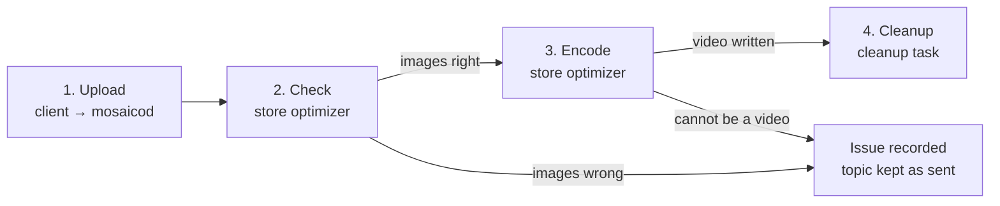
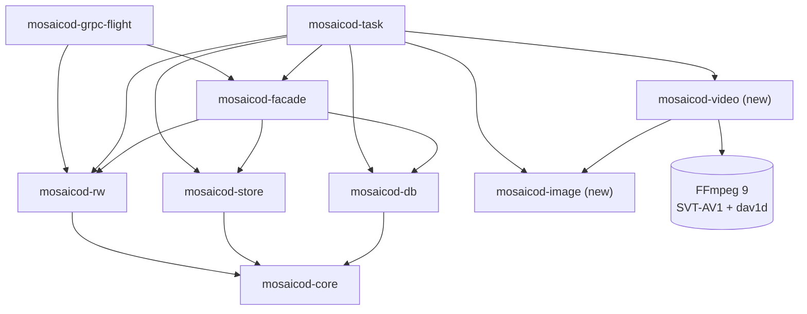

# Image sequences

## Summary

Add an `ImageSequence` ontology and serialization format to Mosaico, to
store the images of a camera, PNG or TIFF, each with the time it was
captured. The client uploads the images as they are. Later, the store
optimizer checks them and turns the whole sequence into an AV1 video, with
a file that keeps the exact timestamps of every frame.

> [!NOTE]
> A first implementation saves image sequences and turns them into videos.
> Reading back a topic that has become a video is not designed yet.

## Motivation

Robots and vehicles record long sequences of camera images, and Mosaico
has no dedicated way to store them:

- There is no ontology for an image of a sequence, with both the time the
  camera took it and the time it was recorded.
- Stored in Parquet, every image is compressed on its own. A PNG is
  already compressed, so it does not get smaller at all. Yet consecutive
  images of a camera are often very close to each other, and a video codec
  can use this to take much less space.

This affects every user who records cameras with Mosaico: the images are
often the largest part of a recording, and so of its storage cost.

## Design

### The data flow, from client to server

An image sequence goes through four phases. Only the first one involves the
client and the server (`mosaicod server`). The others run later, in two
separate processes started with the same binary: `mosaicod store-optimizer`
and `mosaicod cleanup`.



1. **Upload.** The client creates a topic with the `ImageSequence` ontology
   and pushes one message per image. `mosaicod` writes the batches into
   Parquet files (the *chunks* of the topic) as they arrive, **without
   checking the images**: decoding them would make the upload too slow.
2. **Check.** Later, the **store optimizer** (`mosaicod store-optimizer`)
   takes the complete topics that are not optimized yet. A topic is queued
   as soon as its upload is finalized, but it is optimized only when the
   optimizer runs: by default (`--time-interval 0`) it runs once and exits,
   so it must be started by hand or by a scheduler; with a positive
   `--time-interval` it runs in a loop, sleeping that many seconds between
   runs. Several optimizers can run at the same time: each topic is leased
   by one of them. For an image sequence it checks every image: the
   declared format is supported and the same for all the images, the bytes
   are really an image of that format, and the pixels can be decoded.
3. **Encode.** If all the images are right, the optimizer decodes them,
   converts them to 10-bit YUV 4:2:0 and encodes them into an **AV1 video**
   in a Matroska file (`video.mkv`). The exact timestamps of the frames go
   into `timestamps.csv`. Both are written in a new folder of the store, and
   the topic is switched to that folder in a single database transaction.
4. **Cleanup.** The old folder with the Parquet chunks is no longer
   referenced. The **cleanup** (`mosaicod cleanup`) marks it and, on a run
   after the retention period (`--retention-duration`, 24 hours by
   default), deletes it. Like the optimizer, by default it runs once and
   exits, or in a loop with a positive `--time-interval`.

When a phase finds a problem, the topic is **left as the client sent it**
and the problem is written on the topic in the database
(`optimization_issue` and `optimization_issue_message` of `topic_t`):

- `format_mismatch`: a format is missing, unsupported, different from the
  first image's, or does not match the bytes. Found in phase 2.
- `undecodable`: the bytes are not an image, or the pixels are corrupted.
  Found in phase 2.
- `unsupported`: the images are right but cannot become a video without
  losing information (different sizes, transparency, extra columns, a
  layout that cannot be decoded, no images). Found in phase 3.
- `failed`: something outside the data failed (encoder, store, network,
  database). The topic is tried again at the next run of the optimizer.

The first three depend on the data, so the topic is never tried again until
someone clears the issue.

### The ontology

The ontology and the serialization format have the same name, but they are
different things:

- the **ontology** is the shape of each message, what the client sends;
- the **serialization format** is how the server writes the messages on
  disk.

The ontology is defined in the Python SDK
(`mosaicolabs.models.sensors.ImageSequence`). Each message is one image,
with these fields:

- `timestamp_ns` (`int64`): when the image was **recorded**, in nanoseconds
  since the Unix epoch. It comes from the `Message` wrapping the image, as
  for every ontology.
- `capture_timestamp_ns` (`int64`): when the camera **took** the image, in
  nanoseconds since the Unix epoch.
- `format` (`string`): the encoding of the image, `png` or `tiff`
  (`ImageSequenceFormat`). All the images of a topic must have the same
  format.
- `data` (`binary`): the encoded image, the content of a `.png` or `.tiff`
  file.

`format` and `capture_timestamp_ns` can be queried with the `.Q` proxy;
`data` cannot.

### The serialization format

`image_sequence` is a new value of the serialization format, everywhere it
is listed:

- `proto/mosaico/v1/core.proto`: `FORMAT_IMAGE_SEQUENCE = 4`;
- `mosaicod-core`: `types::Format::ImageSequence`;
- Python SDK: `SerializationFormat.ImageSequence`.

On disk it is Parquet, like the other formats. What changes are the
settings of each column, in `mosaicod-rw`
(`ImageSequenceFormatProperties`):

- `timestamp_ns`: uncompressed, with page statistics and a bloom filter, to
  find quickly the images of a time range.
- `capture_timestamp_ns`: ZSTD level 5, with page statistics, to filter by
  capture time.
- `format`: dictionary encoded and ZSTD level 5, with page statistics. The
  value is the same in every row, so it takes almost no space.
- `data`: ZSTD level 3, without statistics. Uncompressed TIFFs get smaller;
  PNGs are already compressed and stay about the same size.
- any other column: uncompressed, without statistics.

The format relies on the column names, so the fields of the ontology must
not be renamed.

### The video

After the store optimizer, the topic is no longer Parquet:

```txt
tp_<id>/
├── metadata.json          copied from the old folder
└── data/
    ├── video.mkv          the images, AV1 in a Matroska file
    └── timestamps.csv     the exact timestamps of every frame
```

The video is encoded with SVT-AV1, by default at preset 6 and CRF 18, one
10-bit frame per image in capture order, each frame at its capture time in
milliseconds. The file is tagged with the first capture time and the
format, color type and bit depth of the source images. Matroska stores
milliseconds, so `timestamps.csv` keeps the nanoseconds:

```csv
frame,timestamp_ns,capture_timestamp_ns,video_timestamp_ms
0,1767225600000000000,1767225599990000000,0
1,1767225600033366667,1767225600023366667,33
```

### The `mosaicod` crates

Two crates are new, `mosaicod-image` and `mosaicod-video`. The others
already exist and are extended. An arrow `A --> B` means "A uses B"; only
the crates involved with image sequences are shown.



What each crate does for image sequences:

- `mosaicod-core`: the shared types. Adds `Format::ImageSequence` and
  `OptimizationIssue` (`format_mismatch`, `undecodable`, `unsupported`,
  `failed`).
- `mosaicod-marshal`: maps the `FORMAT_IMAGE_SEQUENCE` value of the protocol
  to `Format::ImageSequence`.
- `mosaicod-rw`: reads and writes the Parquet chunks. Adds the column
  settings of the `ImageSequence` serialization format.
- `mosaicod-grpc-flight`: the `do_put` endpoint of the upload. It uses only
  `mosaicod-rw`, so it never looks inside the images.
- `mosaicod-db`: the PostgreSQL queries. Adds the `optimization_issue` and
  `optimization_issue_message` columns of `topic_t`, and the queries that
  record and clear them.
- `mosaicod-store`: the filesystem or S3 store. Adds
  `Store::write_from_file`, which uploads a local file in parts of 16 MiB
  (an S3 multipart upload), so the video is never held whole in memory. Its
  testing store can also run on S3.
- `mosaicod-facade`: the operations on topics shared by the server and the
  tasks. Adds `rollback` to the write procedure of a topic, which removes
  the chunks written so far, so that a failed upload can be sent again.
- `mosaicod-image` (new, pure Rust): the supported formats (`ImageFormat`:
  PNG, TIFF), the quick check of the structure of an image (`is_image`,
  `format_of`), the decoding into samples (`decode`), and the conversion to
  and from YUV 4:2:0 (`Image::to_yuv420`, `Yuv420::to_image`).
- `mosaicod-video` (new): encodes YUV 4:2:0 frames into an AV1 video in a
  Matroska file and decodes it back, with FFmpeg (SVT-AV1 to encode, dav1d
  to decode). The encoder and decoder are behind the `ffmpeg` feature, so
  the crate builds without FFmpeg when they are not needed.
- `mosaicod-task`: the background tasks. The store optimizer is split into
  steps shared by every topic (read, copy the metadata, complete the
  optimization), and gets an image sequence path
  (`store_optimizer/image_sequence.rs`) that checks, encodes, writes and
  switches the topic. It is the only crate that uses `mosaicod-image` and
  `mosaicod-video`.

Because `mosaicod-task` enables the `ffmpeg` feature, building `mosaicod`
needs FFmpeg 9 with `libsvtav1` and `libdav1d`. `scripts/install-ffmpeg`
builds it for CI and Docker, since Debian and Ubuntu do not package
FFmpeg 9 yet.

## Drawbacks

- **The video is lossy.** CRF 18 is visually lossless, but not lossless,
  and 16-bit images become 10-bit frames. Once the retention period is
  over, the original images are deleted and cannot be rebuilt exactly.
- **Bad images are found late.** The upload accepts any bytes, and the
  client learns about a bad image only after the optimizer has run.
- **A new system dependency.** Building and running `mosaicod` needs
  FFmpeg 9, which Debian and Ubuntu do not package yet, so it is built from
  source.
- **Encoding is expensive.** It takes CPU time and local disk space on the
  machine of the optimizer, one topic at a time.
- **Reading back is not designed yet.** Until it is, a topic that has
  become a video cannot be downloaded by a client.

## Alternatives

- **Keep the images in Parquet.** This is what the serialization format
  does before the optimizer runs. It is simple and keeps the original
  bytes, but every image is compressed on its own, and PNGs do not get
  smaller.
- **Check the images during the upload.** Decoding every image in `do_put`
  makes the upload too slow for long, high-resolution sequences. Only cheap
  checks could run there (see the open questions).
- **Encode the video during the upload.** It has the same problem as
  checking the images, and the Matroska muxer needs to seek back in the
  file to complete it, which a stream cannot do.
- **A lossless video.** It keeps the images exactly, but takes much more
  space than CRF 18. It could be an option of a topic (see the open
  questions).

## Open questions

Each question is followed by a proposal, when there is one, as a starting
point for the discussion.

The questions about the design must be answered before this RFC is
approved. The questions in [Left to the implementation][implementation]
can only be answered while implementing, and can stay open.

### When the optimizer runs

- **Question:** A topic waits until the next run of the optimizer, which can
  be much later than the upload, or never if nobody starts it. Should the
  optimizer start as soon as an upload is finalized?
  - **Proposal:** when a session is finalized, `mosaicod server` sends a
    PostgreSQL `NOTIFY`. The optimizer runs as a long-lived process that
    `LISTEN`s and starts optimizing right away, keeping `--time-interval`
    as a fallback for the notifications missed while it was down. This
    works across processes, and the leases already keep several optimizers
    from working on the same topic.
- **Question:** Should `mosaicod server` start the optimizer itself, or
  should it stay a separate process?
  - **Proposal:** keep it separate, so that encoding does not take the CPU
    of the server and can run on other machines. The deployment starts it
    as a long-lived process next to the server.
- **Question:** Even when started right away, encoding a long sequence
  takes time, so a topic is still Parquet for a while. What does a client
  get when it reads the topic in the meantime?
  - **Proposal:** reading back works the same in both states: the images as
    sent before the optimization, the decoded video after. The server also
    exposes the optimization state of a topic (pending, optimized, or its
    issue), so that a client that wants the video file itself can wait for
    it.

### Reading the data back

- **Question:** How does a client read a topic that has become a video?
  Does the server decode the frames and send back PNG or TIFF images, or
  does it send the `.mkv` and `timestamps.csv` and let the client decode
  them?
  - **Proposal:** the server decodes the frames and sends images of the
    source format (the `SOURCE_*` tags of the video), so the client API
    does not change. A separate call downloads the `.mkv` and
    `timestamps.csv` for the clients that want the video.
- **Question:** If the server re-encodes the frames into images, the bytes
  will not match the ones the client sent. Is that acceptable, and how do
  we tell the client?
  - **Proposal:** document it in the `ImageSequence` ontology, and use the
    optimization state of the topic to tell whether the images are the
    original ones or decoded from the video.
- **Question:** The video is in capture order, while the topic is indexed
  by `timestamp_ns`. When the two orders differ, in which order are the
  images read back?
  - **Proposal:** in `timestamp_ns` order, like every other topic, using
    `timestamps.csv` to find the frame of each row.
- **Question:** A long recording becomes a single video. How is a time
  range read without decoding the whole file?
  - **Proposal:** encode with a fixed keyframe interval (for example one
    every second), find the frames of the range in `timestamps.csv`, and
    start decoding from the keyframe before them. If that is not enough,
    split long sequences into several videos, as Parquet topics are split
    into chunks.

### Loss of information

- **Question:** CRF 18 is visually lossless, but not lossless. Is that
  acceptable for every user, for example for training data or for
  measurements?
  - **Proposal:** keep CRF 18 as the default, and let a topic choose, at
    creation, lossless AV1 or no conversion at all.
- **Question:** The original images are deleted after the retention period.
  Once the video is written, nothing can rebuild them exactly. Should the
  originals be kept somewhere, considering how much keeping both the images
  and the video costs?
- **Question:** 16-bit images become 10-bit frames. What about 16-bit
  grayscale images that are not pictures but measurements, such as depth
  maps? A lossy encoding changes their values.
  - **Proposal:** do not turn 16-bit grayscale images into a video: keep
    them as Parquet, or let the client mark the topic as measurements at
    creation.

### Checking the images

- **Question:** The upload accepts any bytes, and the client learns about a
  bad image only after the optimizer has run. Should `do_put` reject the
  bad images right away?
  - **Proposal:** `do_put` runs only the cheap checks (format declared,
    supported and the same for all the images, valid signature of the
    bytes) and rejects the batch. Decoding the pixels stays in the
    optimizer.
- **Question:** How does a user find out that a topic has an issue? Today
  it is written only in the database, with no API to read it.
  - **Proposal:** expose the issue and its message with the optimization
    state of the topic, through the API and the Python SDK.
- **Question:** Clearing an issue means editing the database by hand.
  Should there be an API or a command for it?
  - **Proposal:** a `mosaicod` command that clears the issue of a topic and
    queues it again for the optimizer.
- **Question:** A topic with `unsupported` is never tried again. If a later
  version supports what was missing (transparency, different sizes), how
  are those topics optimized again?
  - **Proposal:** the same command clears every `unsupported` issue at once,
    to run after an upgrade.
- **Question:** The `format` is repeated in every message, but must be the
  same in all of them. Should it be declared once per topic?
  - **Proposal:** declare it in the metadata of the topic, at creation, and
    remove the field from the messages.

### Supported images

- **Question:** Images of different sizes are `unsupported`. Is a change of
  resolution in the middle of a recording a real case for the users?
  - **Proposal:** if it is, start a new video each time the size changes.
- **Question:** Transparent images, CMYK or floating point TIFFs, and other
  formats (JPEG, raw Bayer) are not supported. Which of them do users need?
  - **Proposal:** keep them as Parquet with the `unsupported` issue, and add
    a format when users ask for it.

### Deployment

- **Question:** `mosaicod` now depends on FFmpeg 9 built from source. Is
  this acceptable for every deployment?
  - **Proposal:** make the `ffmpeg` feature of `mosaicod-task` optional, so
    that a build without FFmpeg leaves image sequences as Parquet.
- **Question:** The preset and CRF can be changed only in the code
  (`StoreOptimizer::with_video_settings`). Should they be configurable?
  - **Proposal:** add them to the options of `mosaicod store-optimizer` and
    their environment variables, like `--max-chunk-size`.

### Left to the implementation

These questions can only be answered by measuring or testing the
implementation, so they can stay open after this RFC is approved.

- **Question:** The topic still has the `image_sequence` serialization
  format, but its data is no longer Parquet. Do the queries on the topic
  (time ranges, filters on `format` and `capture_timestamp_ns`) still work,
  and which part of the code reads a video chunk?
  - **Proposal:** add an integration test that queries an optimized topic,
    to find out what breaks.
- **Question:** Several frames in the same millisecond are moved forward by
  1 ms each, so the video timestamps can drift from the capture times. Is
  this a problem for cameras faster than 1000 fps?
  - **Proposal:** `timestamps.csv` is the only source of the times, the
    video timestamps only order the frames. Measure the drift on real
    recordings.
- **Question:** Each optimizer encodes one topic at a time. How long does a
  long, high-resolution sequence take, and does it delay the other topics
  in the queue?
  - **Proposal:** measure it on real recordings, and run more optimizers
    when needed: the leases already allow it.
- **Question:** The video is written first to a local temporary file, as
  big as the video. How much local disk does the optimizer need?
  - **Proposal:** document it: each optimizer needs free local disk at least
    as big as the largest video it encodes.

[implementation]: #left-to-the-implementation
