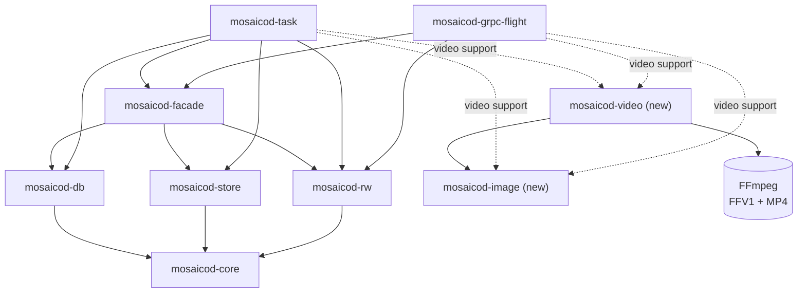

# Image sequences

## Summary

Add two ontologies to Mosaico, with a serialization format each, to store
the images of a camera, each with the time it was captured:

- `ImageSequence`: PNG images, compressed losslessly.
- `ImageSequenceRaw`: raw images, as a camera driver writes them, for
  example a ROS `sensor_msgs/Image`.

They replace the `Image` ontology, which is deprecated. `CompressedImage`,
for lossy images and video streams, does not change.

The client uploads the images as they are. Later, the store optimizer
checks them and turns the whole sequence into a lossless FFV1 video, with a
frame index that keeps every other column of the images: their exact
timestamps, their ROS fields, the layout of raw images.

The FFV1 video keeps every pixel of the images and takes less space than
them, as shown by the [file size graph][filesize] of the
[ffv1-analysis PoC][ffv1-analysis].

So `mosaicod` keeps only the video, not the original images. They are not
deleted right away, though: a separate cleanup process deletes them after a
retention period (24 hours by default), as it already does for the other
files the store no longer uses.

A client reads back the images as they were uploaded (raw images byte for
byte, PNGs pixel for pixel), or the video itself, as MPEG-DASH segments of
one second.

## Motivation

Robots and vehicles record long sequences of camera images, and the images
are often the largest part of a recording, and so of its storage cost.

The `Image` ontology was created to pack the image sequences of ROS bags.
But it does not tell the server that a topic is a sequence it can handle as
a whole:

- **One ontology for different things.** Each message can be raw pixels or
  a PNG, chosen by a field of the message. The server cannot know how to
  read a topic without looking at every image.
- **No capture time.** The time the camera took the image is in an
  optional header. Without it, the server cannot order the frames of a
  video.
- **Separate blobs.** Stored as rows of Parquet files, each image is
  compressed on its own: a PNG does not get any smaller, and raw pixels
  only a little.

We wanted a guarantee per topic: every message is one self-contained
image, all of a topic of the same kind, each with its capture time. With
it, the server can check the images and turn the whole topic into one video
that keeps them exactly.

So `Image` is split into two ontologies, one per kind of image:

- `ImageSequence` for PNGs, which a client already has compressed.
- `ImageSequenceRaw` for raw images, the largest data of all, which the
  video compresses the most. It keeps everything a ROS `sensor_msgs/Image`
  has, so that a ROS bag can be read back exactly.

Each ontology has only the fields its images need, all required but the
optional ones taken from the ROS header. The capture time is a field of its
own, required, instead of being in a header.

This affects every user who records cameras with Mosaico, and in
particular those who record ROS bags.

## Design

### The data flow, from client to server

An image sequence goes through four phases. Only the first one involves the
client and the server, `mosaicod server`. The others run later, in two
separate processes started with the same binary: `mosaicod store-optimizer`
and `mosaicod cleanup`.

1. **Upload.** The client creates a topic with one of the two ontologies
   and pushes one message per image. `mosaicod server` writes them into
   Parquet files, **without checking the images**: decoding them would
   make the upload too slow.
2. **Check.** Later, the **store optimizer** takes the complete topics that
   are not optimized yet. By default it runs once and exits, or it runs in
   a loop. Several optimizers can run at the same time: each topic is
   leased by one of them. For PNGs, it checks every image without decoding
   it: its format is declared, supported and the same for all the images,
   and its bytes are really a PNG. Raw images have nothing to check without
   decoding them.
3. **Encode.** The optimizer decodes the images, once, and encodes them
   into a lossless **FFV1 video**. The video and its frame index are
   written in a new folder of the store, and the topic is switched to that
   folder in a single database transaction.
4. **Cleanup.** The old folder with the Parquet files is no longer
   referenced. The **cleanup** marks it and deletes it after the retention
   period. Like the optimizer, it runs once or in a loop.

### The ontologies

Each message of both ontologies is one image. As in every ontology, the
message wrapping it has `timestamp_ns`: when the image was **recorded**.

`ImageSequence`, PNG images:

| Field | Type | Null | Description |
|---|---|---|---|
| `format` | `string` | no | The encoding of the image: only `png`. |
| `capture_timestamp_ns` | `int64` | no | When the camera **took** the image, in nanoseconds since the Unix epoch. |
| `frame_id` | `string` | yes | The coordinate frame of the camera, from the ROS header. |
| `sample_counter` | `uint64` | yes | The number of the image, from the ROS 1 header (`seq`). |
| `data` | `binary` | no | The PNG. |

`ImageSequenceRaw`, raw images:

| Field | Type | Null | Description |
|---|---|---|---|
| `capture_timestamp_ns` | `int64` | no | When the camera **took** the image, in nanoseconds since the Unix epoch. |
| `width` | `uint32` | no | Pixels per row. |
| `height` | `uint32` | no | Rows. |
| `stride` | `uint32` | no | Bytes per row, padding included. |
| `encoding` | `string` | no | The pixel encoding, as in ROS: `mono8`, `bgr8`, `16UC1`... |
| `is_bigendian` | `bool` | yes | Whether the 16-bit samples are big-endian. Little-endian if null. |
| `frame_id` | `string` | yes | The coordinate frame of the camera, from the ROS header. |
| `sample_counter` | `uint64` | yes | The number of the image, from the ROS 1 header (`seq`). |
| `data` | `binary` | no | The pixels, `stride × height` bytes. |

Every field but `data` can be filtered in queries.

Only **lossless** images are accepted, so that the server stores exactly
the images the camera produced. Lossy images, such as JPEG, stay in
`CompressedImage`.

### ROS images

The ROS bridge turns a `sensor_msgs/Image` into an `ImageSequenceRaw`, and
back into the same message:

| ROS | `ImageSequenceRaw` |
|---|---|
| `header.stamp` | `capture_timestamp_ns` |
| `header.frame_id` | `frame_id`, null if empty |
| `header.seq` (ROS 1 only) | `sample_counter` |
| `width`, `height`, `step` | `width`, `height`, `stride` |
| `encoding`, `is_bigendian` | `encoding`, `is_bigendian` |
| `data` | `data` |

An image whose stamp is zero has no capture time, and is not translated
(see the open questions).

### `Image` is deprecated

`Image` topics can still be written and read. Creating one for writing
warns the user to use `ImageSequenceRaw` instead. The `Image` topics
already stored are still exported to ROS.

### The serialization formats

`ImageSequence` and `ImageSequenceRaw` are two new serialization formats.
On disk they are Parquet, like the other formats: what changes are the
settings of each column.

| Column | Compression | Statistics |
|---|---|---|
| `timestamp_ns` | none | page statistics and a bloom filter |
| `capture_timestamp_ns` | ZSTD | page statistics |
| `format`, `frame_id`, and for raw images `width`, `height`, `stride`, `encoding`, `is_bigendian` | dictionary, then ZSTD | page statistics |
| `data` of a PNG | none: it is compressed already | none |
| `data` of a raw image | ZSTD, fast | none |
| any other column | none | none |

The columns are found by their names, so the fields of the ontologies must
not be renamed.

### The issues

When the optimizer finds a problem, the topic is **left as the client sent
it**, and readable. The problem is written in an `error` notification on
the topic, `store optimizer/<issue>: 
`, with one of these issues:

- `format_mismatch`: a PNG has no format, an unsupported one, or one
  different from the other images.
- `undecodable`: a PNG is not valid or its pixels are corrupted, or the
  bytes of a raw image do not match its size and stride.
- `unsupported`: the images cannot become a video without losing
  information. For example, images of different sizes, a required field
  missing, or a raw encoding the video cannot hold yet.
- `failed`: something outside the data failed: the encoder, the store, the
  network, the database.

The first three depend on the data: the optimization of the topic ends,
and it is never tried again. A `failed` topic is tried again at the next
run, with a notification at every attempt.

### The video

After the optimizer, the topic is no longer Parquet. Its folder has the
video, `video.mp4`, and its frame index, `timestamps.parquet`.

The video is encoded with FFV1, FFmpeg's lossless video codec, in a
fragmented MP4 file: a header, then one fragment per image, in capture
order. Every frame is a keyframe, so any fragment can be decoded without
the others. Each frame is at its capture time, in microseconds from the
first one.

The frames keep exactly the pixels of the images, with no color
conversion: gray, gray with alpha, RGB or RGBA, of 8 or 16 bits.

Raw images can become a video in these encodings:

| Encoding | Frame |
|---|---|
| `mono8`, `8UC1`, the Bayer ones of 8 bits | gray, 8 bits |
| `mono16`, `16UC1`, `16SC1`, the Bayer ones of 16 bits | gray, 16 bits |
| `rgb8`, `bgr8`, `8UC3`, `rgba8`, `bgra8`, `8UC4` | RGB or RGBA, 8 bits |
| `rgb16`, `bgr16`, `16UC3`, `rgba16`, `bgra16`, `16UC4` | RGB or RGBA, 16 bits |

BGR pixels are swapped into RGB, and back when they are read. Big-endian
samples are read in their byte order, and written back in it. The padding
of the rows must be zero, and is written back as zero.

The **frame index** is a Parquet file with one row per frame: where its
fragment is in the video, its time in the video, and every column of its
image but `data`, as uploaded. It also keeps the schema the images were
uploaded with. An image is read back as its row, with its frame decoded as
its `data`.

### Reading back

The client chooses what to read of an image sequence topic:

- **The images**, the default. They come back with the schema they were
  uploaded with, sorted by `timestamp_ns`. A time range keeps those whose
  `timestamp_ns` is in it, as for any topic. Once the topic is a video, raw
  images come back byte for byte, and PNGs pixel for pixel: the server
  encodes them again, so their bytes can differ.
- **The video**, as MPEG-DASH: a manifest, an initialization segment, and
  one media segment per second of video. Every segment starts with a
  keyframe. With no interval, every segment comes back: together with the
  initialization segment, they are the whole video.

An interval asks for the seconds `[start, end)` of the video, second 0
starting at its first frame. It is wrong when it does not start before its
end, when it ends after the video, or when it comes with a time range: then
the request fails. A second with no frames, in a pause of the capture, has
no segment.

The segments are read from the store as byte ranges of the video, without
FFmpeg. Each comes with the exact timestamps of its frames. Before the
topic is a video, asking for the video fails.

FFV1 has no registered codec name in MP4 and DASH. FFmpeg and the tools
built on it read the segments, but browsers and most DASH players do not.

### Deployment

FFmpeg is needed only to encode the videos and to decode them back into
images. So `mosaicod` is built in two ways:

- **Without video support**, the default: it needs no FFmpeg. The server
  reads back the images of the topics not yet a video, and the video
  itself. The store optimizer optimizes every other topic, and leaves the
  image sequences in the queue for one that can.
- **With video support**: FFmpeg is linked inside `mosaicod`, so it needs
  nothing else to run. This is the `mosaicod-optimizer` Docker image.

So the store optimizer can run on a machine with FFmpeg, and the server on
another. When it starts, the optimizer checks that its FFmpeg has the FFV1
codec and the MP4 format. If not, it logs an error and leaves the image
sequences in the queue.

### The `mosaicod` crates

Two crates are new, `mosaicod-image` and `mosaicod-video`. The others
already exist and are extended. An arrow `A --> B` means "A uses B". Only
the crates involved with image sequences are shown.

What each crate does for image sequences:

- `mosaicod-core`: the two new formats and the issues.
- `mosaicod-marshal`: maps the formats and the reading options of the
  protocol.
- `mosaicod-rw`: the column settings of the two formats, and the layout of
  the video and of its frame index, which the server and the optimizer
  share.
- `mosaicod-store`: writes a local file to the store in parts, and reads
  byte ranges of a file.
- `mosaicod-db`: the queue of the optimizer, which can skip the image
  sequences, and the notification of the issues.
- `mosaicod-facade`: finds the video of a topic.
- `mosaicod-image` (new, pure Rust): checks and decodes PNGs, and turns raw
  images into samples and back into the same bytes.
- `mosaicod-video` (new): encodes images into an FFV1 video and decodes it
  back, with FFmpeg, and finds the fragments of a video without it.
- `mosaicod-task`: the store optimizer gets an image sequence path that
  checks, encodes, writes and switches the topic.
- `mosaicod-grpc-flight`: reads back the images, from the Parquet files or
  from the video, and the video as MPEG-DASH segments.

### The Python SDK

The SDK adds the two ontologies and their serialization formats,
deprecates `Image`, and translates ROS images into `ImageSequenceRaw`.

## Drawbacks

- **The video takes more space than a lossy one.** FFV1 keeps every pixel,
  so the 60 8K images of the PoC take 1,279 MiB, 1.5 times less than as
  PNG, while a lossy AV1 video of them takes about 12 MiB (see the
  alternatives).
- **PNG files are not kept.** The video keeps their pixels, but once the
  retention period is over, the rest of the file (its compression, its
  metadata) is lost. Raw images, instead, come back byte for byte.
- **Bad images are found late.** The upload accepts any bytes, and the
  client learns about a bad image only after the optimizer has run.
- **A new dependency, for the optimizer.** Encoding needs FFmpeg, built
  from source for the `mosaicod-optimizer` image.
- **Encoding takes resources.** It takes CPU time, mostly to decode the
  images, and local disk space on the machine of the optimizer, one topic
  at a time.
- **Few players read the video.** FFV1 in MP4 and DASH is read by FFmpeg
  and the tools built on it, not by browsers.
- **Some ROS images are refused.** A ROS image whose stamp is zero cannot
  be translated, and its topic cannot be ingested.

## Alternatives

- **Keep `Image`.** It mixes raw and PNG images in one ontology, and its
  capture time is optional: the server cannot turn its topics into a video
  without checking every image, nor order their frames.
- **One ontology for PNG and raw images.** The layout fields of raw images
  would be null for every PNG, and the server would need to look at each
  image to know how to read it.
- **Keep the ROS header as it is.** Its stamp would repeat the capture
  time, and a struct would carry only two optional fields.
- **Keep the images in Parquet.** This is what the formats do before the
  optimizer runs. It is simple and keeps the original bytes, but every
  image is compressed on its own, PNGs do not get smaller, and a client
  that wants a video has to encode it itself.
- **Check the images during the upload.** Decoding every image while it is
  uploaded makes the upload too slow for long, high-resolution sequences.
- **Accept lossy images, such as JPEG.** Each image has already lost
  information, and a lossless video of the decoded images would take much
  more space than the JPEGs themselves.
- **A lossy video, such as AV1.** It takes much less space: the
  [file size graph][av1-filesize] of the image-sequence PoC shows the same
  60 8K images in 12 MiB with SVT-AV1, 159 times less than as PNG. But it
  loses information: it is visually lossless, not lossless, 16-bit images
  become 10-bit frames, the alpha channel is dropped, and the colors go
  through a conversion.
- **A Matroska file instead of MP4.** Its frames cannot be cut into DASH
  segments read as byte ranges of the file.
- **A CSV frame index.** It needs another library, and keeps only text.
  Parquet is already used everywhere in `mosaicod`, and keeps every type.

## Open questions

Each question is followed by a proposal, when there is one, as a starting
point for the discussion.

The questions about the design must be answered before this RFC is
approved. The questions in [Left to the implementation][implementation]
can only be answered while implementing, and can stay open.

### When the optimizer runs

- **Question:** A topic waits until the next run of the optimizer, which
  can be much later than the upload, or never. Should the optimizer start
  as soon as an upload is finalized?
  - **Proposal:** the server notifies the database when an upload is
    finalized, and the optimizer, always running, starts right away.
- **Question:** Should `mosaicod server` start the optimizer itself?
  - **Proposal:** no, keep it separate, so that encoding does not take the
    CPU of the server and can run on another machine.

### The optimizer

- **Question:** A `failed` topic is tried again at every run, with a new
  notification each time, forever. Should the retries stop at some point?
  - **Proposal:** after a number of attempts, turn the issue into a
    permanent one.
- **Question:** If an optimizer crashes while encoding, its topic stays
  leased for 7 days. Is that too long for image sequences?
  - **Proposal:** renew the lease while encoding, and make it shorter.
- **Question:** The images are decoded in memory, and their size is not
  limited: a PNG can declare a huge image. Should there be a limit?
  - **Proposal:** a maximum number of pixels per image, in the settings.

### Loss of information

- **Question:** PNG files are deleted after the retention period. Should
  they be kept somewhere?
- **Question:** Is 24 hours of retention right for image sequences, which
  take the space of both the images and the video until then?
- **Question:** Should a topic also get a lossy video, such as AV1, for
  the clients that only look at the images?
  - **Proposal:** not now. Add it later as a second video, when users need
    it.

### Queries

- **Question:** The catalog queries and the time range info of a topic
  read its files as Parquet. Once the topic is a video, its files are the
  video and the frame index. How do they work on an optimized topic?
  - **Proposal:** read the frame index instead: it has every column but
    the images.
- **Question:** The images are filtered by the time they were recorded,
  the video by the seconds of capture. Is having two timelines confusing?
  - **Proposal:** keep both, and let the images be filtered by capture time
    too.

### Reading back

- **Question:** Reading the images of a video needs a server with video
  support, which the default `mosaicod` image does not have. Should every
  server have it?
  - **Proposal:** yes: the server image links FFmpeg too, as the optimizer
    image does.
- **Question:** The server decodes the video and encodes the PNGs again at
  every read of the images. Can many clients read at once?
  - **Proposal:** limit the reads decoded at the same time.
- **Question:** A segment is read whole in memory. A second of 8K video at
  60 fps is more than a gigabyte. Should a segment be streamed instead?
  - **Proposal:** stream the fragments of a segment one at a time.
- **Question:** Segments last one second. Is it right for every camera,
  from one image every few seconds to hundreds per second?
- **Question:** The Python SDK cannot read the video yet. What should it
  offer?
  - **Proposal:** read the segments of an interval, and decode them into
    images with PyAV.

### ROS images

- **Question:** A ROS image whose stamp is zero has no capture time. The
  time it was recorded in the bag is not it. What should we do with these
  images?
- **Question:** A ROS `CompressedImage` in PNG is lossless. Should it
  become an `ImageSequence`?
  - **Proposal:** yes, when every image of the topic is a PNG.
- **Question:** An `ImageSequence` cannot be exported to ROS. Should it?
  - **Proposal:** export it as a `CompressedImage` in PNG.

### `Image`

- **Question:** What happens to the `Image` topics already stored? Should
  they be converted?
  - **Proposal:** convert the raw ones into `ImageSequenceRaw` with a
    command, so that they become videos too.
- **Question:** When is `Image` removed?

### Checking the images

- **Question:** Should the upload reject bad images right away?
  - **Proposal:** the upload runs only the cheap checks, such as a missing
    or unsupported format. Decoding stays in the optimizer.
- **Question:** A topic with an issue is never optimized again. How is it
  optimized after a version that supports it?
  - **Proposal:** a `mosaicod` command that queues these topics again.
- **Question:** The `format` of PNGs is the same in every message. Should
  it be declared once per topic?
  - **Proposal:** declare it in the metadata of the topic.

### Supported images

- **Question:** Images of different sizes are `unsupported`. Do users
  change resolution in the middle of a recording?
  - **Proposal:** if they do, start a new video at each change.
- **Question:** YUV raw images (`yuv422`, `uyvy`, `yuyv`) are
  `unsupported`. Should they become videos too?
  - **Proposal:** yes: their samples can be rearranged into planes, which
    FFV1 encodes losslessly.
- **Question:** Depth images in floating point (`32FC1`) are `unsupported`:
  FFV1 has no single channel of 32-bit floats. Should they become videos?
  - **Proposal:** split each float into two 16-bit channels, if users need
    it.
- **Question:** Raw images whose row padding is not zero are `unsupported`,
  because the video loses the padding. Should they become videos too?
  - **Proposal:** keep the padding apart, for example in the frame index.

### Left to the implementation

These questions can only be answered by measuring or testing the
implementation, so they can stay open after this RFC is approved.

- **Question:** Do the queries that filter on the fields of an image
  sequence still work once the topic is a video?
  - **Proposal:** add an integration test that queries an optimized topic.
- **Question:** How long does a long, high-resolution sequence take to
  encode, and does it delay the other topics in the queue?
  - **Proposal:** measure it on real recordings, and run more optimizers
    when needed.
- **Question:** How much local disk does the optimizer need?
  - **Proposal:** document it: at least as much as the largest video it
    encodes.
- **Question:** Small images get a fragment each, with a header of its own.
  Can the video take more space than the images?
  - **Proposal:** measure it, and keep the images in Parquet when it does.
- **Question:** The frame index has no version. How is its layout changed
  later?
  - **Proposal:** write a version in its metadata.
- **Question:** Long gaps between frames rely on internals of FFmpeg's MP4
  writer. Do they still work with the next versions of FFmpeg?
  - **Proposal:** keep the test of long gaps, and run it at every upgrade
    of FFmpeg.
- **Question:** The ZSTD level of the Parquet columns can only be built at
  runtime, with an error to handle. Can the Parquet library build a valid
  level without it?
  - **Proposal:** propose it upstream, to Apache Arrow.

[implementation]: #left-to-the-implementation
[ffv1-analysis]: https://github.com/mosaico-labs/video-pocs/tree/main/ffv1-analysis
[filesize]: https://github.com/mosaico-labs/video-pocs/blob/main/ffv1-analysis/results/reference/ffv1/filesize-input.svg
[av1-filesize]: https://github.com/mosaico-labs/video-pocs/blob/main/image-sequence/video-results/regular/batch_060/preset_5_crf_18/filesize-comparison/filesize-comparison.svg
